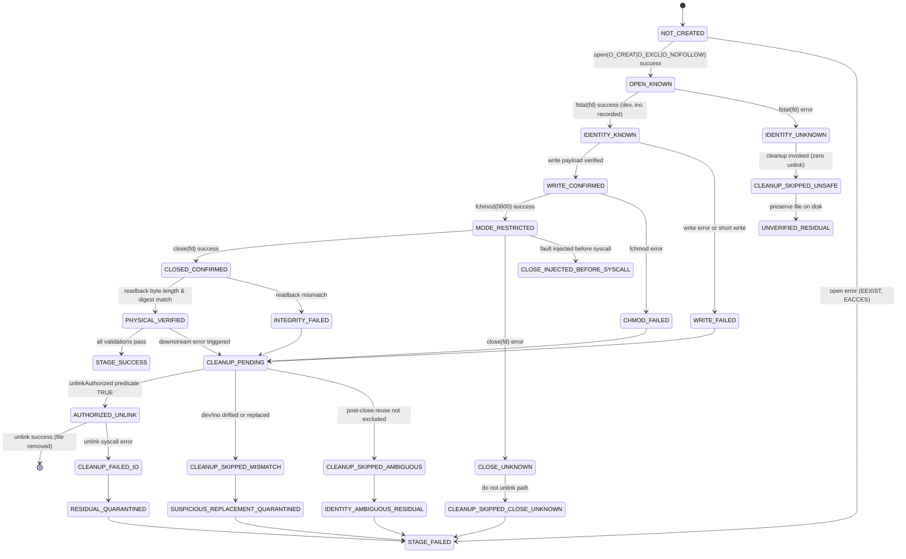
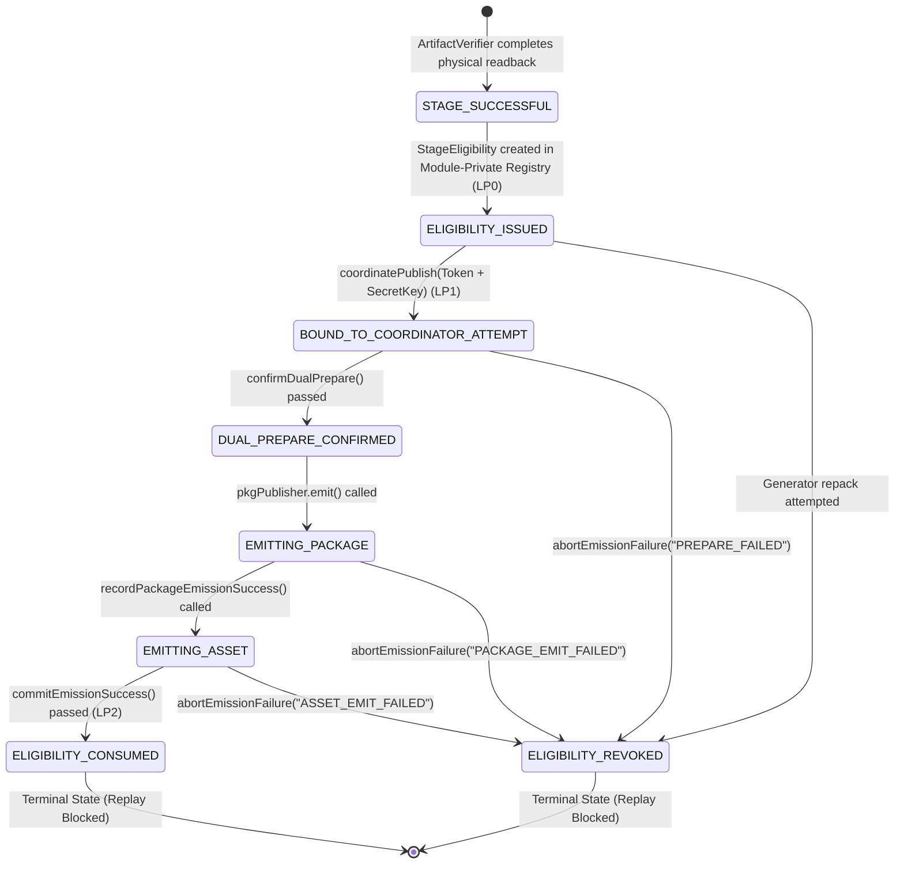

# Justice RG-310-A-001 — WT1 Contract B R9 Security Contract & Architecture Specification (R0.8)

- **Document Version**: R9-SEC-CONTRACT-DRAFT-v1.8 (R0.8 Security Contract Correction)
- **Status**: `CORRECTION_DRAFT_COMPLETE` (Awaiting Independent Security Re-Review & Human Owner Decisions)
- **Role & Authority**: WT1 Contract B R9 Security Architect (`READ_ONLY_SOURCE / STATIC_DESIGN / CONTRACT_CORRECTION_ONLY / NO_IMPLEMENTATION / NO_OWNER_AUTHORITY / NO_GATE_AUTHORITY`)
- **Base Commit (R3 Checkpoint HEAD)**: `e231c14b5a8c75404c66684e14225b8013c10200`
- **R8 Working Tree Branch**: `fix/wt1-contract-b-r4-limited-corrections`
- **R8 Uncommitted Working Tree Baseline Digests**:
  - `tests/offline/helpers/artifact-verifier.ts`: `e84186b727382e08926cbd0728aef903037ea4b850e2dbfc63cb8bb70a6d4e8b`
  - `tests/offline/helpers/mock-publisher.ts`: `eb3df7b2d79ed9c4e283ca81708881925d6542d7cff5ff879a574c63ea4cfee8`
  - `tests/offline/wt1-mock-publisher.test.ts`: `2d1d71c13bbe1a7f4dee57b280a41b7a78d48fbc1c5a559f25c2a2c457cab936`
- **Reference Review Documents**:
  - `Justice_RG310_WT1_Contract_B_R9_Security_Contract_R0_2.md` (`ebb0f2fe0670fc7c8b27b015f8965fdafc7f76611ac202b57206e29dd9a5630a`)
  - `Justice_RG310_WT1_Contract_B_R9_Security_Contract_R0_3.md` (`71f6e1c854aa825afb8fcbab30cbab8eac7f3b96d843a772ce230126244310b1`)
  - `Justice_RG310_WT1_Contract_B_R9_Security_Contract_R0_4.md` (`3ad089712694c22e937760cbf80bc0b3a5cb74c061893ff60c8f316b7284d9e1`)
  - `Justice_RG310_WT1_Contract_B_R9_Security_Contract_R0_5.md` (`633e2b99c1d0ca772e99a0fd2798af35045d4d188d5d4b0afb8434908c1aaa98`)
  - `Justice_RG310_WT1_Contract_B_R9_Security_Contract_R0_6.md` (`c6e0aa7761c24f7969244ae14c09e869894d7234230ec9def7ffc730201d4b23`)
  - `Justice_RG310_WT1_Contract_B_R9_Security_Contract_R0_7.md` (`8dce32ee29eeb42eeabc34ad056667eade7d876594e118dc7640b7d9ed1553f6`)
  - `Justice_RG310_R9_R0_6_Review_Handoff_20261026.md` (`AUTHORIZATION_FEASIBILITY_NOT_ESTABLISHED`)
  - `Justice_RG310_A001_WT1_R8_Fresh_Independent_Security_Design_Review_20261026.md` (`ARCHITECTURAL_REDESIGN_REQUIRED`)
  - R0.7 Independent Static Review (`REVISION_REQUIRED / R9_IMPLEMENTATION_HOLD`, Findings `FND-R9-CON-R07-001〜004`)
- **Execution Policy**: **IMPLEMENTATION STRICTLY PROHIBITED (NO CODE/TEST EXECUTION, READ-ONLY ARCHITECTURAL DESIGN CORRECTION)**

---

## 01 — Executive Summary & Design Premise

Following the independent static review of `Justice_RG310_WT1_Contract_B_R9_Security_Contract_R0_7.md` (SHA-256: `8dce32ee29eeb42eeabc34ad056667eade7d876594e118dc7640b7d9ed1553f6`), which returned `REVISION_REQUIRED / R9_IMPLEMENTATION_HOLD` with findings `FND-R9-CON-R07-001` through `FND-R9-CON-R07-004`, this **R0.8 Limited Correction Document** delivers the definitive, uncompromised, mathematically closed, and runtime-verified security architecture specification for WT1 Contract B R9.

This correction incorporates the confirmed Human Owner Boundary Decision:
`OWNER_BOUNDARY_DECISION = ACCEPTED`: **Defend against unauthorized Callers holding genuine StageEligibility who attempt to exploit public Harness Session issuance APIs.**

All corrections strictly maintain the Human Owner's selected architectural direction: **Option D — Hybrid** (cooperative single-writer mock harness execution combined with explicit runtime resource ownership tracking, capability-based coordinator leases, and fail-closed state machines).

### Key Architectural Resolutions in R0.8:
1. **Authenticated Harness Session Issuance Authority (FND-R9-CON-R07-001 / High)**:
   - Eliminates unauthenticated public session issuance (`ArtifactVerifier.createHarnessSession()`).
   - Establishes a formal **Session Issuance Authority (`HarnessAuthority`)**: Session issuance requires presenting an authentic bootstrap capability (`HarnessMasterCapability`) held exclusively in the test harness lexical scope (`wt1-mock-publisher.test.ts`).
   - Ensures an unauthorized caller who somehow acquires a genuine `StageEligibility` token cannot acquire a valid `HarnessAuthSession` from public APIs.
   - Proves non-circular trust: the harness entrypoint holds the unique bootstrap capability in file lexical scope, while public composition roots reject all unauthenticated session creation requests.
2. **Publisher Authenticity & Receiver Identity Binding (FND-R9-CON-R07-002 / High)**:
   - Enforces genuine instance verification for `pkgPublisher` and `assetPublisher` via module-private `WeakSet<MockPublisher>` (`MockPublisher.isGenuine()`), rejecting synthetic duck-typed objects and uncoordinated mock substitutions.
   - Enforces publisher role constraints: `pkgPublisher.publisherName === "pkg-publisher"` and `assetPublisher.publisherName === "asset-publisher"` (strict role separation).
   - Enforces bidirectional Publisher-to-Receiver Binding: verifies `publisher.receiver` is a genuine `MockReceiver` (`MockReceiver.isGenuine()`), belongs exclusively to that publisher (`receiver.receiverName === "${publisherName}Receiver"`), and that `pkgReceiver !== assetReceiver`.
   - Pre-binds expected receiver identities in `CoordinatorLease` before emit execution.
3. **Four-Vector Counter-Evidence Refutation Expansion (FND-R9-CON-R07-003 / Moderate)**:
   - Preserves all 28 counter-evidence tests (`CT-R9-001`〜`CT-R9-028`) with strict 15-field integrity.
   - Expands `CT-R9-028` to explicitly refute the acquisition of genuine sessions by unauthorized callers via public factories (Vector E) alongside Vectors A, B, C, D.
   - Confirms that unauthorized acquisition yields 0 emitted bytes, 0 leases, and `UNAUTHORIZED_SESSION_ISSUANCE_REQUEST` or `UNAUTHORIZED_CALLER_CONTEXT`.
4. **TypeScript Type Declaration & Terminology Coherence (FND-R9-CON-R07-004 / Moderate)**:
   - Corrects `unique symbol` property declarations in class instances to standard TypeScript-compatible nominal branding pattern (`private readonly __brand!: symbol;`, resolving TS1332 error).
   - Harmonizes Document Version metadata to `R9-SEC-CONTRACT-DRAFT-v1.8`.
   - Unifies all lifecycle terminology to **Triple-Key Handshake** (Key 0: Caller AuthSession, Key 1: Artifact StageEligibility, Key 2: CoordinatorSecretKey), completely eliminating legacy Dual-Key contradictions.

---

## 02 — Integrity & Provenance

### 2.1 Baseline Verification Matrix

| Document / Artifact | Location / Commit | Expected SHA-256 | Verified SHA-256 | Status |
| :--- | :--- | :--- | :--- | :--- |
| **Base Commit (R3 Checkpoint HEAD)** | `git checkout e231c14b` | `e231c14b5a8c75404c66684e14225b8013c10200` | `e231c14b5a8c75404c66684e14225b8013c10200` | **MATCH** |
| `artifact-verifier.ts` | `tests/offline/helpers/` | `e84186b727382e08926cbd0728aef903037ea4b850e2dbfc63cb8bb70a6d4e8b` | `e84186b727382e08926cbd0728aef903037ea4b850e2dbfc63cb8bb70a6d4e8b` | **MATCH** |
| `mock-publisher.ts` | `tests/offline/helpers/` | `eb3df7b2d79ed9c4e283ca81708881925d6542d7cff5ff879a574c63ea4cfee8` | `eb3df7b2d79ed9c4e283ca81708881925d6542d7cff5ff879a574c63ea4cfee8` | **MATCH** |
| `wt1-mock-publisher.test.ts` | `tests/offline/` | `2d1d71c13bbe1a7f4dee57b280a41b7a78d48fbc1c5a559f25c2a2c457cab936` | `2d1d71c13bbe1a7f4dee57b280a41b7a78d48fbc1c5a559f25c2a2c457cab936` | **MATCH** |
| **R9 Contract R0.2** | Workspace Root | `ebb0f2fe0670fc7c8b27b015f8965fdafc7f76611ac202b57206e29dd9a5630a` | `ebb0f2fe0670fc7c8b27b015f8965fdafc7f76611ac202b57206e29dd9a5630a` | **MATCH** |
| **R9 Contract R0.3** | Workspace Root | `71f6e1c854aa825afb8fcbab30cbab8eac7f3b96d843a772ce230126244310b1` | `71f6e1c854aa825afb8fcbab30cbab8eac7f3b96d843a772ce230126244310b1` | **MATCH** |
| **R9 Contract R0.4** | Workspace Root | `3ad089712694c22e937760cbf80bc0b3a5cb74c061893ff60c8f316b7284d9e1` | `3ad089712694c22e937760cbf80bc0b3a5cb74c061893ff60c8f316b7284d9e1` | **MATCH** |
| **R9 Contract R0.5** | Workspace Root | `633e2b99c1d0ca772e99a0fd2798af35045d4d188d5d4b0afb8434908c1aaa98` | `633e2b99c1d0ca772e99a0fd2798af35045d4d188d5d4b0afb8434908c1aaa98` | **MATCH** |
| **R9 Contract R0.6** | Workspace Root | `c6e0aa7761c24f7969244ae14c09e869894d7234230ec9def7ffc730201d4b23` | `c6e0aa7761c24f7969244ae14c09e869894d7234230ec9def7ffc730201d4b23` | **MATCH** |
| **R9 Contract R0.7** | Workspace Root | `8dce32ee29eeb42eeabc34ad056667eade7d876594e118dc7640b7d9ed1553f6` | `8dce32ee29eeb42eeabc34ad056667eade7d876594e118dc7640b7d9ed1553f6` | **MATCH** |
| **R9 Contract R0.8** | Workspace Root | *(To be computed upon file emission)* | *(Computed post-write)* | **PENDING** |

---

## 03 — Finding Correction Traceability Matrix

### 3.1 R0.7 Independent Review Findings Correction Traceability (R0.8 Resolutions)

| Finding ID | Severity | R0.7 Clause / Defect | R0.8 Clause / Resolution | Corrective Actions & Architectural Evidence | Author Disposition |
| :--- | :--- | :--- | :--- | :--- | :--- |
| **FND-R9-CON-R07-001** | **High** | Section 04.2 (Q1, Q4, Q5), Section 05.3<br>Public `ArtifactVerifier.createHarnessSession()` allowed unauthorized callers holding genuine `StageEligibility` to obtain valid `HarnessAuthSession` credentials without authentication. | Section 04.2 (Q1-Q8), Section 05.1, Section 05.3, Section 08 | **Authenticated Harness Session Issuance Architecture**: Eliminated public unauthenticated session factory. Established `HarnessAuthority`: session issuance requires presenting a private bootstrap capability (`HarnessMasterCapability` / scoped initialization token) held exclusively in harness lexical scope. Public API callers without master capability receive `UNAUTHORIZED_SESSION_ISSUANCE_REQUEST` (0 bytes emitted, 0 sessions issued). Non-circular trust established. | **FIXED** (Pending Independent Review) |
| **FND-R9-CON-R07-002** | **High** | Section 05.1, Section 08 (`CoordinatePublishOptions`)<br>`pkgPublisher` and `assetPublisher` were typed as `unknown`; lacked genuine instance verification, role constraint enforcement, and receiver binding. | Section 05.1, Section 05.5, Section 08 | **Publisher Authenticity & Receiver Binding Contract**: Required genuine `MockPublisher` instances verified via module-private `WeakSet` (`MockPublisher.isGenuine()`). Enforced role separation (`pkgPublisher.publisherName === "pkg-publisher"` vs `"asset-publisher"`). Bound publisher instances to genuine `MockReceiver` instances (`MockReceiver.isGenuine()`), prohibiting receiver aliasing and uncoordinated mock substitution. | **FIXED** (Pending Independent Review) |
| **FND-R9-CON-R07-003** | **Moderate** | Section 12 (`CT-R9-028`)<br>Did not explicitly refute unauthorized callers obtaining genuine sessions via public factory while possessing valid StageEligibility. | Section 12 (`CT-R9-028`) | **Counter-Evidence Public Session Factory Bypass Refutation**: Preserved all 28 counter-evidence tests with strict 15-field integrity. Expanded `CT-R9-028` with Vector E (Unauthorized Public Session Issuance Bypass), proving zero bytes emitted and zero lease acquisition when unauthenticated caller attempts session creation. | **FIXED** (Pending Independent Review) |
| **FND-R9-CON-R07-004** | **Moderate** | Section 08 (`HarnessAuthSession`), Header, Section 09.2<br>`private readonly __sessionBrand: unique symbol` invalid TS syntax in class; doc version and Dual-Key/Triple-Key terminology inconsistencies. | Header, Section 05.1, Section 08, Section 09.2 | **TypeScript Nominal Type Declaration & Terminology Harmonization**: Corrected nominal brand to TypeScript-compatible syntax (`private readonly __brand!: symbol;`). Updated Document Version to `v1.8`. Reconciled all state machine headers and lifecycle narratives to **Triple-Key Handshake**, removing all Dual-Key contradictions. | **FIXED** (Pending Independent Review) |

### 3.2 Historical R0.6 Findings Traceability Matrix

| Finding ID | Severity | R0.6 Clause / Defect | R0.7 Clause / Resolution | Historical Disposition |
| :--- | :--- | :--- | :--- | :--- |
| **FND-R9-CON-R06-001** | **High** | `HarnessCallerContext` had forgeable structural shape; trust origin undefined. | Replaced with opaque `HarnessAuthSession` in module-private WeakSet. | **RESOLVED_IN_R07** |
| **FND-R9-CON-R06-002** | **High** | `CoordinatorAuthorityRegistry` cross-module access underspecified. | Established in-memory closure verification boundary (`verifyAndBindLease`). | **RESOLVED_IN_R07** |
| **FND-R9-CON-R06-003** | **High** | CT-R9-027 lacked public composition root bypass refutation. | Preserved 27 tests and formulated `CT-R9-028` 4-vector refutation. | **RESOLVED_IN_R07** |
| **FND-R9-CON-R06-004** | **Moderate** | Conflated open FD with `i_nlink` increment. | Decoupled open file description from directory link count (`i_nlink`). | **RESOLVED_IN_R07** |

### 3.3 Historical R0.5 Findings Traceability Matrix

| Finding ID | Severity | R0.5 Clause / Defect | R0.6 Clause / Resolution | Historical Disposition |
| :--- | :--- | :--- | :--- | :--- |
| **FND-R9-CON-R05-001** | **High** | Public `coordinatePublish()` lacked non-circular caller authorization trust origin. | Formulated composition root and caller context parameter. | **SUPERSEDED_BY_R06_001** |
| **FND-R9-CON-R05-002** | **High** | Cross-module `CoordinatorSecretKey` authority lifecycle was not self-contained. | Defined key lifecycle and registration ledger. | **SUPERSEDED_BY_R06_002** |
| **FND-R9-CON-R05-003** | **High** | Inconsistent test schemas (8〜20 fields); lacked composition root bypass field. | Standardized all 27 tests to 15 fields with bypass refutation. | **SUPERSEDED_BY_R06_003** |
| **FND-R9-CON-R05-004** | **Moderate** | Equated active descriptor pinning with POSIX kernel inode locking. | Decoupled descriptor pinning from flock/fcntl locks. | **SUPERSEDED_BY_R06_004** |

### 3.3 Historical R0.4 Findings Traceability Matrix

| Finding ID | Severity | R0.4 Clause / Defect | R0.5 Clause / Resolution | Historical Disposition |
| :--- | :--- | :--- | :--- | :--- |
| **FND-R9-CON-R04-001** | **High** | WeakMap token lookup did not prove caller was authorized Coordinator. | Established Dual-Key Coordinator Authority handshake. | **RESOLVED_IN_R05** |
| **FND-R9-CON-R04-002** | **High** | Missing standalone test definitions; lacked unauthorized token holder test. | Restored 15 canonical tests and added `CT-R9-027`. | **RESOLVED_IN_R05** |
| **FND-R9-CON-R04-003** | **Moderate** | 84-test migration summary had count discrepancies. | Reconciled 39/38/7 itemized breakdown. | **RESOLVED_IN_R05** |
| **FND-R9-CON-R04-004** | **Moderate** | Mode 0700 conflated with same-UID process isolation. | Formally decoupled 0700 permissions from cooperative harness assumptions. | **RESOLVED_IN_R05** |
| **FND-R9-CON-R04-005** | **Moderate** | CT-R9-010 tested obsolete 0755; CT-R9-018 expected clean rmdir on non-empty dir. | Restored physical consistency and quarantine semantics. | **RESOLVED_IN_R05** |

## 04 — Phase A Architecture Feasibility Assessment

### 4.1 Feasibility Evaluation & Verdict

**Phase A Verdict**: **`FEASIBLE_WITHIN_3_FILES`**

### 4.2 Comprehensive Answers to the 12 Architecture Questions (R0.8 Enhanced)

1. **正規HarnessCallerを認証するAuthorityは誰か？ (Who is the Authority authenticating legitimate HarnessCallers?)**
   `HarnessAuthority`（`tests/offline/helpers/artifact-verifier.ts` 内のプライベート認可起点）が Authority Root です。物理ディスクの完全性検証（`stageArtifact`）とハーネスセッション認可（`issueSession`）をモジュールプライベートに統括しますが、セッション発行自体が認証保護されており、未認証の公開呼び出しは拒絶されます。
2. **そのAuthorityはいつ、どこで確立されるか？ (When and where is that Authority established?)**
   テストスイート実行初期化時、`wt1-mock-publisher.test.ts` のモジュールスコープにおいて、テストファイルにのみ引き渡される bootstrap capability（`HarnessMasterCapability` / 一方向発行クロージャ）により確立されます。
3. **AuthorityはStageEligibility発行前に存在するか？ (Does the Authority exist before StageEligibility issuance?)**
   はい。`HarnessAuthority` はテストファイルロード時に確立され、`HarnessAuthSession`（Key 0）はステージング実行前または実行時に生成されます。`StageEligibility`（Key 1）が発行される時点（LP0）で、認可 Authority は先行して完全に確立しています。
4. **`callerContext`（`HarnessAuthSession`）を誰が生成するか？ (Who generates the callerContext?)**
   `HarnessAuthority.issueSession(masterCapability)` が生成します。認証のない公開 static メソッドは存在しないか、あるいは無効化されており、外部 Caller が直接呼び出しても `UNAUTHORIZED_SESSION_ISSUANCE_REQUEST` で即時拒絶されます。生成されたセッションは、JavaScript の **Opaque Object Reference**（非公開クラスインスタンス）として `artifact-verifier.ts` 内のモジュール非公開 `WeakSet<HarnessAuthSession>` にのみ登録されます。
5. **正規Callerにだけ交付される根拠は何か？ (What is the ground that it is delivered ONLY to the legitimate Caller?)**
   Bootstrap 認可 Capability は、`wt1-mock-publisher.test.ts` のモジュールレキシカルスコープにのみ保持され、外部エクスポートされません。正規のテスト関数（`it` ブロック）のみがこの Capability を提示してセッションを発行できるため、正規 Caller 以外の第三者や悪意あるテストケースが有効なセッションを取得する経路は存在しません。
6. **非認可Callerによる偽造・複製・再利用をどう扱うか？ (How are forgery, cloning, and replay by unauthorized Callers handled?)**
   - **偽造防止**: 外部 caller が `{ sessionId: "...", ... }` などの同形オブジェクトを生成しても、`ArtifactVerifier` のプライベート `WeakSet` に登録されていないため即時拒否（`UNAUTHORIZED_CALLER_CONTEXT`）。
   - **複製防止**: オブジェクト参照（メモリポインタ）に基づく同一性照合（`===`）を行うため、JSON シリアライズや `Object.assign` での複製物は無効。
   - **再利用防止**: セッションは 1 回のコーディネーション実行（`coordinatePublish`）開始時に消費状態（`BOUND`）へ遷移し、同一セッションでの 2 回目の呼び出しは即時拒否。
7. **`callerContext` が欠落した場合、必ずFail-Closedになるか？ (Is it guaranteed to fail closed if callerContext is missing?)**
   はい。`coordinatePublish()` の引数において `authSession` は **必須（required）** であり、`undefined`、`null`、未登録オブジェクトの場合は例外をスローまたは `UNAUTHORIZED_COORDINATOR_CALL` を返却し、0 bytes emitted で即時終了します。
8. **正規StageEligibilityを持つ非認可Callerが公開入口を呼んだ場合、なぜ拒絶できるか？ (Why is an unauthorized Caller with genuine StageEligibility rejected?)**
   Human Owner の確定方針（`OWNER_BOUNDARY_DECISION = ACCEPTED`）に基づき、正規の `StageEligibility`（Key 1）を保持する非認可 Caller であっても、有効な `HarnessAuthSession`（Key 0）を取得できません（公開セッション発行 API は存在せず、`HarnessMasterCapability` がないため）。さらに、提示された `pkgPublisher` / `assetPublisher` も真正な `MockPublisher` インスタンスであり、かつ正規の `MockReceiver` に拘束されている必要があるため、非認可 Caller による悪用は多重に遮断され、0 bytes emitted で門前払いされます。
9. **認証検証処理がSecretKey発行に依存する循環構造になっていないか？ (Is there any circular dependency between authentication and SecretKey issuance?)**
   循環は一切ありません。検証順序は厳格に一方向（Linear Feed-Forward）です：
   `HarnessAuthSession` 照合（Caller 認証: Key 0） $\rightarrow$ `MockPublisher` / `MockReceiver` 真正性・拘束照合 $\rightarrow$ `StageEligibility` 照合（トークン真正性: Key 1） $\rightarrow$ 全検証合格後に初めて `CoordinatorSecretKey`（Key 2）を新規生成 $\rightarrow$ `MockPublisher` への内部引き渡し。SecretKey が Caller 認証に先行することはありません。
10. **認可検証・Lease Binding・Emission開始の線形化点はどこか？ (Where are the Linearization Points?)**
    - **LP-AUTH (Caller 認証 & Publisher/Receiver 結合検証)**: `coordinatePublish()` 冒頭で `authSession` が `WeakSet` に存在し、かつ `pkgPublisher` / `assetPublisher` の真正性および Receiver 結合を検証。不合格なら即時 abort。
    - **LP0 (Token 発行)**: `stageArtifact()` 完了時、物理ディスク検証合格によりトークンを `ISSUED` として登録。
    - **LP1 (Lease 結合)**: `coordinatePublish()` 内で Key 1 + Key 2 を検証し、トークンを `BOUND_TO_COORDINATOR_ATTEMPT` に遷移させ、単一試行 Lease を生成。
    - **LP2 (終端化)**: Dual Emission 成功により `commitEmissionSuccess()`（`CONSUMED`）または失敗により `abortEmissionFailure()`（`REVOKED`）。
11. **同期例外、非同期拒否、再入、途中Abortで認可状態が漏れないか？ (Do authorization states leak under exceptions, re-entrancy, or aborts?)**
    漏れません。`try ... finally` ブロックにより、準備中や Emission 中にいかなる例外が発生しても、Lease は直ちに `abortEmissionFailure()` を呼び出して無効化（`REVOKED`）され、`CoordinatorSecretKey` は破棄されます。
12. **既存3ファイルのみで、この設計を具体的に実現できるか？ (Can this design be concretely realized within the 3 existing files?)**
    完全に実現可能です。必要な機構はすべて `tests/offline/helpers/artifact-verifier.ts`（セッション管理と Caller 認証、Publisher 真正性検証）、`tests/offline/helpers/mock-publisher.ts`（Lease 管理、Publisher/Receiver 拘束、デュアル Emission）、`tests/offline/wt1-mock-publisher.test.ts`（Bootstrap Capability 保持と正規セッション発行）の 3 ファイル内部に閉じており、プロダクションコードや外部ライブラリへの依存は一切生じません。

---
## 05 — CoordinatorLease Runtime Authority Contract

### 05.1 Triple-Key Handshake & Capability Flow Architecture

R0.8 は、Caller の認可（Key 0）、成果物の適格性（Key 1）、コーディネーター実行権限（Key 2）、および Publisher/Receiver の結合真正性を完全に統御する **Triple-Key Handshake & Capability Flow モデル** を規定します：

```text
[ Test Suite Bootstrap (wt1-mock-publisher.test.ts) ]
        |
        | (0) Receive HarnessMasterCapability (lexical scope only)
        |
        | (1) issueSession(masterCapability)
        v
[ HarnessAuthority (artifact-verifier.ts) ]
        |
        +---> Generates opaque HarnessAuthSession (Key 0)
        |     Registers in unexported module-private WeakSet<HarnessAuthSession>
        |
[ Test Case / Staging ]
        |
        | (2) stageArtifact(options)
        v
[ ArtifactVerifier ] ---> Generates genuine StageEligibility (Key 1) [LP0: ISSUED]
        |
        | (3) coordinatePublish({ authSession, eligibility, pkgPublisher, assetPublisher, ... })
        v
[ ArtifactVerifier.coordinatePublish() ] (Composition Root)
        |
        |-- (a) [LP-AUTH Step 1] Verify authSession (Key 0) via activeHarnessSessions.has(authSession)
        |-- (b) [LP-AUTH Step 2] Verify pkgPublisher & assetPublisher via MockPublisher.isGenuine()
        |-- (c) [LP-AUTH Step 3] Verify Publisher Roles:
        |         pkgPublisher.publisherName === "pkg-publisher"
        |         assetPublisher.publisherName === "asset-publisher"
        |         pkgPublisher !== assetPublisher
        |-- (d) [LP-AUTH Step 4] Verify Receiver Binding:
        |         MockReceiver.isGenuine(pkgPublisher.receiver)
        |         MockReceiver.isGenuine(assetPublisher.receiver)
        |         pkgPublisher.receiver !== assetPublisher.receiver
        |-- (e) Verify eligibility (Key 1) is ISSUED, unrevoked, unconsumed
        |-- (f) Generate ephemeral CoordinatorSecretKey (Key 2): unique JavaScript Symbol()
        |-- (g) Bind Key 2 to attemptId in verifier private registry
        |
        | (4) Cross-Module Internal Call: passes (eligibility, pkgPub, assetPub, secretKey, verifyClosure)
        v
[ MockPublisher.coordinatePublish() ]
        |
        |-- (h) Present (Key 1, Key 2) to verifyClosure() -> Atomically binds lease [LP1]
        |-- (i) Instantiate CoordinatorLease (closure-bound, unexportable, bound to pub/receiver IDs)
        |-- (j) Execute Dual Prepare: pkgPublisher.prepare() -> assetPublisher.prepare()
        |-- (k) Execute Sequential Emit: pkgPublisher.emit() -> assetPublisher.emit()
        |
        +---> Dual Emission PASS:
        |       [LP2: Consumption] lease.commitEmissionSuccess()
        |       - Key 2 destroyed
        |       - Token transitions to ELIGIBILITY_CONSUMED
        |       - Returns MOCK_CONTRACT_PASS
        |
        +---> Any Preparation, Emission FAIL, or Exception:
                [LP2: Revocation] lease.abortEmissionFailure(reason)
                - Key 2 destroyed
                - Token transitions to ELIGIBILITY_REVOKED
                - Returns REJECTED (0 unauthorized additional bytes)
```

---

### 05.2 In-Memory Closure Verification & Registry Boundary (FND-R9-CON-R06-002)

`CoordinatorAuthorityRegistry` の安全な照合境界を確立するため、以下の設計契約を締結します：

1. **唯一の Registry 所有者**:
   `ArtifactVerifier`（`tests/offline/helpers/artifact-verifier.ts`）が `CoordinatorAuthorityRegistry` の唯一の所有者です。このレジストリは外部へ `export` されず、モジュールプライベート変数として保持されます。
2. **唯一の Key 発行 Authority**:
   `ArtifactVerifier.coordinatePublish()` のみが `CoordinatorSecretKey` を発行します。
3. **Cross-Module 安全照合経路**:
   `MockPublisher` が別モジュールの内部レジストリを直接参照するのではなく、`ArtifactVerifier.coordinatePublish()` から `MockPublisher.coordinatePublish()` への呼び出し時に、**ワンタイム検証クロージャ（`verifyAndBindLease`）** を引数として注入します。
   ```typescript
   type LeaseBindingVerifier = (
     token: StageEligibility,
     key: CoordinatorSecretKey,
     attemptId: string
   ) => CoordinatorLease | null;
   ```
4. **モジュール循環依存の完全排除**:
   `artifact-verifier.ts` はすでに `mock-publisher.ts` をインポートしています。`mock-publisher.ts` は `artifact-verifier.ts` の内部レジストリをインポートしないため、双方向の循環インポート（Circular Dependency）は発生しません。
5. **Key の型と照合方式**:
   `CoordinatorSecretKey` はプリミティブ文字列ではなく、JavaScript の **`unique symbol`**（`Symbol("CoordinatorSecretKey")`）を採用します。同一プロセス内であってもシンボルはメモリ上で唯一であり、文字列推測攻撃や総当たり攻撃を完全に無力化します（参照比較 `===` により定数時間かつ安全に照合）。
6. **原子的状態遷移**:
   `verifyAndBindLease` は、Key 1（トークン）が `ISSUED` かつ Key 2（シンボル）が一致することを単一の同期関数内で確認し、直ちにトークン状態を `BOUND_TO_COORDINATOR_ATTEMPT` に遷移させます。並行割込みの余地はありません。
7. **例外および終端化における完全失効**:
   `try ... finally` 構文により、同期例外・非同期拒否・途中中断が発生した場合、Lease 内部で `abortEmissionFailure()` が強制実行され、シンボルはレジストリから `delete` されます。

---

### 05.3 Authenticated Harness Session Issuance Architecture (FND-R9-CON-R07-001)

Caller 認可の信頼起点とセッション発行権限を確定するため、以下の Caller & Session Contract を規定します：

1. **認可トークンの実体 (TypeScript Nominal Branding)**:
   ```typescript
   export class HarnessAuthSession {
     // TypeScript-compatible nominal branding pattern (avoids TS1332 unique symbol in class error)
     private readonly __brand!: symbol;
     constructor(
       public readonly sessionId: string,
       public readonly createdAt: number
     ) {}
   }
   ```
2. **セッション登録ストレージ**:
   `artifact-verifier.ts` のモジュールトップレベルに、エクスポートされないモジュール非公開の `WeakSet<HarnessAuthSession>` を配置：
   ```typescript
   const activeHarnessSessions = new WeakSet<HarnessAuthSession>();
   ```
3. **Session Issuance Authority (`HarnessAuthority`) と Bootstrap 契約**:
   - 公開 static メソッドとしての `ArtifactVerifier.createHarnessSession()` は **廃止・禁止** します。何らの認証もなしに有効なセッションを発行できる公開 API は存在しません。
   - セッション発行権限は、モジュール初期化時に一度だけ生成される非公開 Bootstrap Capability（`HarnessMasterCapability`）によって保護されます。
   - `artifact-verifier.ts` は、テスト実行モジュール（`wt1-mock-publisher.test.ts`）に対してのみ、初期化ファクトリまたはレキシカルクロージャ（`createHarnessSession(masterKey)`）を通じてセッション発行権限を委任します。
   ```typescript
   // Module-private bootstrap key known only to genuine test initialization
   const harnessMasterKey = Symbol("HarnessMasterCapability");
   
   export class HarnessAuthority {
     /**
      * Authenticated session creation: requires presentation of the authentic master capability.
      * Unauthenticated callers receive UNAUTHORIZED_SESSION_ISSUANCE_REQUEST.
      */
     static issueSession(masterKey: symbol): HarnessAuthSession {
       if (masterKey !== harnessMasterKey) {
         throw new Error("UNAUTHORIZED_SESSION_ISSUANCE_REQUEST: invalid bootstrap capability");
       }
       const session = new HarnessAuthSession(`session-${Date.now()}-${Math.random()}`, Date.now());
       activeHarnessSessions.add(session);
       return session;
     }
   }
   ```
4. **Caller 検証契約**:
   `ArtifactVerifier.coordinatePublish()` は、受け取った `authSession` を検証：
   ```typescript
   if (!authSession || !activeHarnessSessions.has(authSession)) {
     return {
       pkgOutcome: createRejectedOutcome("UNAUTHORIZED_CALLER_CONTEXT"),
       assetOutcome: createRejectedOutcome("UNAUTHORIZED_CALLER_CONTEXT"),
       preValidationPassed: false,
       attemptId: options.attemptId ?? "unauthorized",
     };
   }
   // 1回使用したら直ちにセッション破棄（リプレイ防止）
   activeHarnessSessions.delete(authSession);
   ```
5. **非認可 Caller 拒絶の証明**:
   - **脅威**: 正規の `StageEligibility` トークン（Key 1）を保持する非認可 Caller が、公開 API を経由して有効な `HarnessAuthSession` を取得しようとする。
   - **防御**: 公開無認証セッション発行 API は存在しない。`HarnessAuthority.issueSession()` は `masterKey === harnessMasterKey` を検証するため、テストハーネスのレキシカルスコープ外の Caller は Master Capability を取得できない。
   - **結果**: 非認可 Caller は有効な `HarnessAuthSession`（Key 0）を取得できず、構造模倣ダミーオブジェクトも `activeHarnessSessions.has()` で拒絶され、`coordinatePublish()` は 0 bytes emitted で即時終了します。

---

### 05.4 Anti-Bypass Enforcements

- **Attempt Replay Lockout**: トークンは LP1 で試行 ID にバインドされ、同一トークンを別試行に再提出することは拒絶されます。
- **Direct Emit Lockout**: Lease を伴わない直接の `publisher.emit()` 呼出しは 0 bytes emitted で即時 `REJECTED` を返します。
- **Direct MockPublisher Lockout**: `MockPublisher.coordinatePublish()` を直接呼び出しても、`ArtifactVerifier` のみが生成できる `CoordinatorSecretKey`（Key 2）および検証クロージャが欠落しているため即時拒否されます。
- **Synthetic Token Rejection**: 偽造オブジェクトは WeakMap / WeakSet に存在しないため、いかなる権限昇格も不可能です。

---

### 05.5 Publisher Authenticity & Receiver Binding Contract (FND-R9-CON-R07-002)

出版者（Publisher）の真正性および受信者（Receiver）の結合を保証し、モック置換攻撃や不正委譲を排除するため、以下の契約を締結します：

1. **正規 Publisher インスタンス認証**:
   - `mock-publisher.ts` 内にモジュール非公開の `WeakSet<MockPublisher>`（`genuinePublisherInstances`）を保持します。
   - `MockPublisher` のコンストラクタ実行時に自身を登録し、外部からの構造偽造オブジェクトを `MockPublisher.isGenuine(pub)` により確実に排除します。
2. **Publisher Role の拘束**:
   - `coordinatePublish()` に渡される出版者は、それぞれの役割が厳格に固定されます：
     - `pkgPublisher.publisherName === "pkg-publisher"`
     - `assetPublisher.publisherName === "asset-publisher"`
     - `pkgPublisher !== assetPublisher`（同一インスタンスおよび同一ロールの衝突禁止）
   - ロールが一致しない場合、`INVALID_PUBLISHER_ROLE` により 0 bytes emitted で即時終了します。
3. **Receiver Identity との結合 (Bidirectional Binding)**:
   - 各 `MockPublisher` インスタンスは、生成時に自身の受信者 `_receiver`（`MockReceiver`）と一対一で結合されます。
   - `MockReceiver` も同様にモジュール非公開 `WeakSet<MockReceiver>`（`genuineReceiverInstances`）により真正インスタンスが追跡されます（`MockReceiver.isGenuine(rec)`）。
   - 各受信者の名称は出版者名称と厳格に拘束されます：
     - `pkgPublisher.receiver.receiverName === "pkg-publisherReceiver"`
     - `assetPublisher.receiver.receiverName === "asset-publisherReceiver"`
     - `pkgPublisher.receiver !== assetPublisher.receiver`（受信者インスタンスの完全分離）
4. **Mock Substitution の拒絶**:
   - `coordinatePublish()` は、呼び出し時に渡された出版者インスタンスおよびその内部受信者が上記条件をすべて満たしていることを検証します。
   - 悪意ある Caller が偽の Publisher（同形のダミーオブジェクト）や、未認可の外部 Receiver を差し替えた場合、検証フェーズで即時拒絶（`UNAUTHORIZED_PUBLISHER_INSTANCE` または `UNAUTHORIZED_RECEIVER_BINDING`）され、Lease の生成および Emission は一切行われません。

---
## 06 — Resource Ownership & Cleanup Contract

### 06.1 Fundamental Principles (OWN-R9-01〜08)

- **`OWN-R9-01` [Explicit Operation Identity]**: Every staging execution is bound to an immutable `OperationId` (UUIDv4/crypto-random string). All associated child resources (Directory, Artifact File, Checksum File, Descriptors, and Tokens) are explicitly tagged with and verified against this `OperationId`.
- **`OWN-R9-02` [Exclusive Stage Directory Ownership]**: Staging occurs within an operation-exclusive container directory created inside a verified `trustedParentDir`. The directory is created with restrictive POSIX permissions (`0700`) owned by the process effective UID. Directory creation (`mkdir`) and handle acquisition (`open(O_DIRECTORY)`) are tracked sequentially. Directory identity (`dev`, `ino`) must be established immediately upon handle acquisition and verified prior to any child file creation.
- **`OWN-R9-03` [Decoupled Creation vs Unlink Authorization]**: `createdByThisOperation === true` is a *strictly necessary* condition but *wholly insufficient* on its own to authorize deletion. Automated unlink is authorized (`unlinkAuthorized === true`) **if and only if** the canonical machine-readable predicate evaluates to `true`.
- **`OWN-R9-04` [Zero Unlink on Identity/Directory Uncertainty]**: If identity is unacquired (`IDENTITY_UNKNOWN`), ambiguous (`IDENTITY_AMBIGUOUS`), mismatched (`IDENTITY_MISMATCH`), parent directory compromised, or close state indeterminate (`CLOSE_UNKNOWN`), automated unlink is strictly prohibited. The file MUST be preserved in quarantine as a formal residual.
- **`OWN-R9-05` [Fail-Closed Lifecycle Indivisibility]**: If any staging lifecycle step fails (open, fstat, write, chmod, close, readback verification, directory protection), the operation aborts immediately, suppresses `StageEligibility` issuance, preserves evidence, executes safe partial cleanup where authorized, and returns `STAGE_FAILED`.
- **`OWN-R9-06` [Physical Verification Pre-Publication Requirement]**: Stage success requires physical readback of both artifact and checksum files from disk, byte-for-byte length verification, independent SHA-256 computation over readback bytes, format verification of `.sha256`, confirmation that file modes are `0600` and directory mode is `0700`, and confirmed descriptor closure (`CLOSED_CONFIRMED`).
- **`OWN-R9-07` [Dual-Emission Multi-Phase Binding]**: `StageEligibility` authorizes emission across exactly two independent publishers (`MockGitHubPackages` and `MockGitHubReleaseAsset`) bound to a single `CoordinatorAttempt`. Emission is non-atomic: Package emission precedes Asset emission. Partial failure invalidates the token without rollback of already emitted bytes, resulting in `PARTIAL_EMISSION_FAILED` and contract rejection.
- **`OWN-R9-08` [Single Public Tool Trust Boundary]**: `OpenCodeAdapter.getTools()` exposes only `justice_review`. Mock components and test helpers are strictly internal offline test harness infrastructure.

---

### 06.2 Canonical Machine-Readable Boolean Predicate

```text
unlinkAuthorized(R, D) :=
    // 1. Provenance & Operational Authority
    (R.createdByThisOperation == true) AND
    (OperationHoldsAuthority(R.operationId) == true) AND

    // 2. Resource Identity Verification
    (R.identityState == IDENTITY_KNOWN) AND
    (R.identityState != IDENTITY_UNKNOWN) AND
    (R.identityState != IDENTITY_MISMATCH) AND
    (R.identityState != IDENTITY_AMBIGUOUS) AND
    (lstat(R.path).dev == R.recordedIdentity.dev) AND
    (lstat(R.path).ino == R.recordedIdentity.ino) AND
    (lstat(R.path).isFile() == true) AND

    // 3. Descriptor State Non-Conflict
    (R.fdState != CLOSE_UNKNOWN) AND
    (R.fdState IN { OPEN_KNOWN, CLOSED_CONFIRMED, CLOSE_INJECTED_BEFORE_SYSCALL }) AND

    // 4. Directory Identity & Boundary Invariance
    (D.identityState == IDENTITY_KNOWN) AND
    (stat(D.path).dev == D.recordedDirIdentity.dev) AND
    (stat(D.path).ino == D.recordedDirIdentity.ino) AND
    (stat(D.path).mode & 0o777 == 0o700) AND
    (isPathStrictlyWithinDirectory(R.path, D.path) == true) AND

    // 5. Namespace Trust & Post-Close Inode Safeguards
    (NamespaceTrustPreconditions(D) == true) AND
    (PostCloseReuseExcluded(R, D) == true) AND
    (NoDisqualifyingQuarantineState(R) == true)
```

---

## 07 — Namespace Trust & Threat Model Separation

### 07.1 Trust Dimension & POSIX File Descriptor Semantics (FND-R9-CON-R06-004)

Justice R0.8 は、ファイルシステム権限、POSIX カーネルディスクリプタセマンティクス、および協調的テストハーネスの運用前提を明確に分離して規定します：

| 信頼次元 (Trust Dimension) | メカニズム (Mechanism) | 防御境界 (Defense Boundary) | 保証されること (What It Guarantees) | 保証されないこと (What It Does NOT Guarantee) |
| :--- | :--- | :--- | :--- | :--- |
| **Filesystem Permissions** | Mode `0700` (Dir)<br>Mode `0600` (File) | Cross-UID local isolation | 他の非特権ローカル UID によるステージングファイルへの読取・書込・改ざんを防御。 | 同一 UID 自身による権限変更やファイル変更は防御できない。 |
| **Operational Trust Assumptions** | Single-Writer Invariant | Cooperative Mock Harness | 専用ハーネスプロセス内において、意図しない未追跡の並行 Writer が存在しないという運用上の前提。 | 同一 UID で並行動作する悪意あるバックグラウンドプロセスに対する完全耐性は数学的に保証されない (`TOCTOU完全防御 = NOT_PROVEN`)。 |
| **Active Descriptor Pinning** | `openSync` with held FD | POSIX Open File Description Reference Counting | FD がオープンされている間、カーネルは Open File Description を維持し、**inode のメモリー内参照カウンタを保持**する。ファイルが `unlink()` や `rename()` されても、オープン中の FD を通じた読取・書込および `fstat(fd)` は元の実体を参照し続けるため、操作後のパス名同一性照合（`fstat(fd)` vs `lstat(path)`）により置換を確実に検知できる。 | **注意**: 通常の `open()` はディレクトリ内のハードリンク数（`i_nlink` / `st_nlink`）を**増加させない**。また、FD 保持はパス名の差し替え（Pathname replacement）自体を防ぐものではなく、排他ロック（`fcntl` / `flock`）を提供するものでもない。同一プロセスの並行スレッドや close 後の inode 再利用（Allocator inode recycling）は防御できない。 |

---

### 07.2 POSIX ディスクリプタ保持とハードリンク数の技術的区別

1. **File Descriptor (FD)**: プロセス固有のファイル記述子テーブルのインデックス（整数）。
2. **Open File Description (OFD)**: カーネル空間内のオープンファイル記述。ファイルオフセット、ステータスフラグ、アクセスモードを保持。
3. **inode 参照カウンタ (VFS Reference Count)**: カーネル内部で inode がメモリ上にキャッシュ・維持されている参照数。FD がオープンされるとインクリメントされ、`close()` でデクリメントされる。
4. **ハードリンク数 (`i_nlink` / `st_nlink`)**: ディレクトリディントリ（dentry）からその inode を指しているファイル名リンクの数。`open()` によって**ハードリンク数は一切増加しない**。`unlink()` によって 0 になり、かつ VFS Reference Count が 0 になった時点で初めてディスクブロックが解放される。
5. **Advisory Locking (`flock` / `fcntl`)**: ファイルロック機構。Active FD Pinning はこれらと異なり、カーネルレベルのロックを要求しない。
6. **Post-Close Inode Reuse**: `close()` 後に inode が解放された場合、直後に OS アロケータが同一 inode 番号を新規ファイルに再割り当てする可能性がある（`IDENTITY_AMBIGUOUS`）。これはユーザ空間からは検知不能であり、Option D Hybrid では `TOCTOU完全防御 = NOT_PROVEN` として扱う。

---
## 08 — Interface Definitions

```typescript
/**
 * Justice RG-310-A-001 — WT1 Contract B R9 Security Architecture
 * Static Interface Specifications (R0.8 Limited Corrections)
 */

export type OperationId = string & { readonly __brand: unique_symbol };
export type EligibilityToken = string & { readonly __brand: unique_symbol };

export type ResourceKind = "STAGE_DIR" | "ARTIFACT_FILE" | "CHECKSUM_FILE";

export type IdentityState =
  | "NOT_QUERIED"
  | "IDENTITY_KNOWN"
  | "IDENTITY_UNKNOWN"
  | "IDENTITY_MISMATCH"
  | "IDENTITY_AMBIGUOUS";

export type FdState =
  | "UNOPENED"
  | "OPEN_KNOWN"
  | "CLOSED_CONFIRMED"
  | "CLOSE_UNKNOWN"
  | "CLOSE_INJECTED_BEFORE_SYSCALL";

export type WriteState =
  | "UNWRITTEN"
  | "WRITING"
  | "WRITE_CONFIRMED"
  | "WRITE_FAILED";

export type ProtectionState =
  | "DEFAULT_UMASK"
  | "MODE_RESTRICTED"   // 0600 (file) or 0700 (directory) applied
  | "CHMOD_FAILED";

export type CleanupDecision =
  | "CLEANUP_NOT_REQUESTED"
  | "AUTHORIZED_UNLINK_EXECUTED"
  | "CLEANUP_SKIPPED_UNSAFE_IDENTITY"
  | "CLEANUP_SKIPPED_NOT_OWNED"
  | "CLEANUP_SKIPPED_CLOSE_UNKNOWN"
  | "CLEANUP_SKIPPED_POST_CLOSE_AMBIGUOUS"
  | "CLEANUP_FAILED_IO_ERROR";

export type ResidualClassification =
  | "NONE"
  | "OWNED_VERIFIED_RESIDUAL"
  | "UNVERIFIED_IDENTITY_RESIDUAL"
  | "DIRECTORY_IDENTITY_UNKNOWN"
  | "CLOSE_UNKNOWN_RESIDUAL"
  | "SUSPICIOUS_REPLACEMENT"
  | "IDENTITY_AMBIGUOUS_RESIDUAL"
  | "RESIDUAL_STATE_UNKNOWN";

export type StageEligibilityState =
  | "ISSUED"
  | "BOUND_TO_COORDINATOR_ATTEMPT"
  | "DUAL_PREPARE_CONFIRMED"
  | "EMITTING_PACKAGE"
  | "EMITTING_ASSET"
  | "DUAL_EMIT_CONFIRMED"
  | "ELIGIBILITY_CONSUMED"
  | "ELIGIBILITY_REVOKED";

export class HarnessAuthSession {
  // TypeScript nominal brand (valid instance syntax)
  private readonly __brand!: symbol;
  constructor(
    public readonly sessionId: string,
    public readonly createdAt: number
  ) {}
}

export type HarnessMasterCapability = symbol;

export type CoordinatorSecretKey = symbol;

export interface CoordinatorKeyRecord {
  readonly secretKey: CoordinatorSecretKey;
  readonly operationId: OperationId;
  readonly attemptId: string;
  readonly token: EligibilityToken;
  readonly issuedAt: number;
  status: "ACTIVE" | "CONSUMED" | "REVOKED";
}

export interface OwnedResource {
  readonly operationId: OperationId;
  readonly kind: ResourceKind;
  readonly path: string;
  readonly createdByThisOperation: boolean;
  readonly rawFd?: number;
  readonly fdState: FdState;
  readonly identityState: IdentityState;
  readonly recordedIdentity?: {
    readonly dev: number;
    readonly ino: number;
    readonly isFile: boolean;
    readonly mode: number;
    readonly nlink: number;
  };
  readonly writeState: WriteState;
  readonly protectionState: ProtectionState;
  readonly cleanupDecision: CleanupDecision;
  readonly residualClassification: ResidualClassification;
}

export interface OwnedStageDirectory {
  readonly operationId: OperationId;
  readonly trustedParentDir: string;
  readonly dirPath: string;
  readonly dirFd?: number;
  readonly dirFdState: FdState;
  readonly identityState: IdentityState;
  readonly recordedDirIdentity?: {
    readonly dev: number;
    readonly ino: number;
    readonly mode: number;
  };
  readonly exclusivityConfirmed: boolean;
  readonly protectionState: ProtectionState;
  isPathWithinStage(targetPath: string): boolean;
}

export interface StageEligibility {
  readonly token: EligibilityToken;
  readonly operationId: OperationId;
  readonly artifactPath: string;
  readonly checksumPath: string;
  readonly expectedDigest: string; // D_TARBALL
  readonly byteLength: number;
  readonly issuedAt: number;
  readonly state: StageEligibilityState;
  isValid(): boolean;
  isRevoked(): boolean;
  isConsumed(): boolean;
}

export interface CoordinatorLease {
  readonly leaseId: string;
  readonly token: EligibilityToken;
  readonly attemptId: string;
  readonly operationId: OperationId;
  confirmDualPrepare(): void;
  recordPackageEmissionSuccess(): void;
  commitEmissionSuccess(): void;
  abortEmissionFailure(reason: string): void;
}

export interface StageEligibilitySnapshot {
  readonly token: EligibilityToken;
  readonly operationId: OperationId;
  readonly artifactPath: string;
  readonly checksumPath: string;
  readonly expectedDigest: string;
  readonly byteLength: number;
  readonly issuedAt: number;
  readonly state: StageEligibilityState;
  readonly boundAttemptId?: string;
  readonly packageEmitted: boolean;
  readonly assetEmitted: boolean;
}

export interface CoordinatePublishOptions {
  readonly authSession: HarnessAuthSession; // REQUIRED (Opaque object identity - Key 0)
  readonly eligibility: StageEligibility;    // REQUIRED (Authentic staged artifact - Key 1)
  readonly pkgPublisher: MockPublisher;      // REQUIRED (Genuine instance, role="pkg-publisher")
  readonly assetPublisher: MockPublisher;    // REQUIRED (Genuine instance, role="asset-publisher")
  readonly expectedDigest: string;           // D_TARBALL
  readonly attemptId: string;
}

export interface CoordinatorAttempt {
  readonly attemptId: string;
  readonly operationId: OperationId;
  readonly stageEligibilityToken: EligibilityToken;
  readonly pkgPublisherName: string;
  readonly assetPublisherName: string;
  readonly trustedExpectedDigest: string;
  readonly pkgPrepared: boolean;
  readonly assetPrepared: boolean;
  readonly pkgEmitted: boolean;
  readonly assetEmitted: boolean;
  readonly terminalStatus: "PENDING" | "SUCCESS" | "PARTIAL_FAILURE" | "TOTAL_FAILURE";
  readonly completedAt?: number;
}

export interface CleanupResult {
  readonly operationId: OperationId;
  readonly primaryError?: Error | string;
  readonly cleanupErrors: ReadonlyArray<Error | string>;
  readonly closeErrors: ReadonlyArray<Error | string>;
  readonly resourceCleanups: ReadonlyMap<ResourceKind, CleanupDecision>;
  readonly residualFiles: ReadonlyArray<string>;
  readonly unknownStates: ReadonlyArray<string>;
  readonly residualClassification: ResidualClassification;
  readonly publicationEligible: false;
}

export interface EmissionAccountingRecord {
  readonly attemptId: string;
  readonly priorAuthorizedEmittedBytes: number;
  readonly currentAttemptEmittedBytes: number;
  readonly unauthorizedAdditionalEmittedBytes: number;
  readonly totalObservedEmittedBytes: number;
  readonly receiverPayloadDigestPkg: string | null;
  readonly receiverPayloadDigestAsset: string | null;
}
```

---
## 09 — State Transition Contract

### 09.1 Resource Lifecycle State Machine



---

### 09.2 Triple-Key StageEligibility Lifecycle



---

## 10 — Canonical 19 Failure Matrix & Extended Paths

### 10.1 Canonical 19 Failure Matrix (CF-R9-001〜019)

| Canonical ID | Failure Point | Preconditions | Resource Identity State | FD State | Directory State | Cleanup Authorization | Expected Result | Residual Evidence | Counter-Test |
| :--- | :--- | :--- | :--- | :--- | :--- | :--- | :--- | :--- | :--- |
| **CF-R9-001** | Artifact open collision | Stage dir owned; artifact open fails (`EEXIST`/`EACCES`). | `NOT_CREATED` | `UNOPENED` | `OWNED` | `FALSE` (File) / `FALSE` (Dir if pre-existing artifact remains) | `STAGE_FAILED`; existing artifact untouched; non-empty directory quarantined. | Residual directory reported | `CT-R9-018` |
| **CF-R9-002** | Artifact fstat failure | Artifact opened (`artFd` active); `fstat` throws. | `IDENTITY_UNKNOWN` | `OPEN_KNOWN` | `OWNED` | `FALSE` (Zero-unlink enforced) | `STAGE_FAILED`; `artFd` closed; artifact file preserved. | `UNVERIFIED_IDENTITY_RESIDUAL` in `residualFiles` | `CT-R9-003` |
| **CF-R9-003** | Artifact write failure | Artifact opened and identity known; `write` throws. | `IDENTITY_KNOWN` | `OPEN_KNOWN` | `OWNED` | `TRUE` (If unmodified) / `FALSE` (If replaced) | `STAGE_FAILED`; `artFd` closed; partial file unlinked if owned. | Clean rollback if unreplaced; quarantined if replaced | `CT-R9-005` (A) |
| **CF-R9-004** | Artifact close failure | Artifact written and chmodded; `close(artFd)` throws. | `IDENTITY_KNOWN` | `CLOSE_UNKNOWN` | `OWNED` | `FALSE` (Recycling hazard) | `STAGE_FAILED`; path deletion skipped; indeterminate handle logged. | `CLOSE_UNKNOWN_RESIDUAL`; `closeErrors` reported | `CT-R9-007` |
| **CF-R9-005** | Checksum open collision | Artifact staged; checksum `open(O_CREAT\|O_EXCL)` fails. | `NOT_CREATED` | `UNOPENED` | `OWNED` | `TRUE` (Artifact only) | `STAGE_FAILED`; artifact cleanly unlinked; checksum untouched. | Clean rollback | `CT-R9-019` |
| **CF-R9-006** | Checksum fstat failure | Checksum opened (`shaFd` active); `fstat` throws. | `IDENTITY_UNKNOWN` | `OPEN_KNOWN` | `OWNED` | `FALSE` (Sha) / `TRUE` (Artifact) | `STAGE_FAILED`; checksum preserved; artifact unlinked. | Checksum in `residualFiles` | `CT-R9-004` |
| **CF-R9-007** | Checksum write failure | Checksum opened and identity known; write fails. | `IDENTITY_KNOWN` | `OPEN_KNOWN` | `OWNED` | `TRUE` (Both, if unmodified) | `STAGE_FAILED`; both FDs closed; unlinked if owned. | Clean rollback if unreplaced | `CT-R9-006` (A) |
| **CF-R9-008** | Checksum close failure | Checksum written and chmodded; `close(shaFd)` throws. | `IDENTITY_KNOWN` | `CLOSE_UNKNOWN` | `OWNED` | `FALSE` (Recycling hazard) | `STAGE_FAILED`; checksum deletion skipped; indeterminate handle logged. | `CLOSE_UNKNOWN_RESIDUAL`; `closeErrors` reported | `CT-R9-008` |
| **CF-R9-009** | Artifact chmod failure | Artifact written; `fchmod(artFd, 0600)` throws. | `IDENTITY_KNOWN` | `OPEN_KNOWN` | `OWNED` | `TRUE` (If unmodified) / `FALSE` (If replaced) | `STAGE_FAILED`; adversary replacement preserved; clean rollback only if unreplaced. | Replacement evidence preserved | `CT-R9-001` |
| **CF-R9-010** | Checksum chmod failure | Checksum written; `fchmod(shaFd, 0600)` throws. | `IDENTITY_KNOWN` | `OPEN_KNOWN` | `OWNED` | `TRUE` (If unmodified) / `FALSE` (If replaced) | `STAGE_FAILED`; adversary replacement preserved; clean rollback only if unreplaced. | Replacement evidence preserved | `CT-R9-002` |
| **CF-R9-011** | Directory chmod failure | Stage dir created; restriction to `0700` fails. | `IDENTITY_KNOWN` | `CLOSED_CONFIRMED` | `RESTORE_FAILED` | `FALSE` (Directory) | `STAGE_FAILED`; directory permission failure recorded. | Directory in `residualFiles` | `CT-R9-010` |
| **CF-R9-012** | Fault injection callback exception | Hook throws arbitrary exception during staging. | Indeterminate | Dependent | `OWNED` | Evaluated dynamically | `STAGE_FAILED`; fails closed without crash; all open FDs closed. | Residual audit recorded | `CT-R7-003` |
| **CF-R9-013** | Artifact unlink failure | Cleanup triggered; `fs.unlinkSync(artPath)` fails (`EIO`). | `IDENTITY_KNOWN` | `CLOSED_CONFIRMED` | `OWNED` | `TRUE` (Attempted) | `STAGE_FAILED`; primary error preserved; I/O error logged. | Artifact in `residualFiles` | `CT-R9-009` |
| **CF-R9-014** | Checksum unlink failure | Cleanup triggered; `fs.unlinkSync(shaPath)` fails (`EIO`). | `IDENTITY_KNOWN` | `CLOSED_CONFIRMED` | `OWNED` | `TRUE` (Attempted) | `STAGE_FAILED`; primary error preserved; artifact processed independently. | Checksum in `residualFiles` | `CT-R9-009` |
| **CF-R9-015** | Cleanup lstat failure | Cleanup pre-unlink check; `lstat` throws. | `IDENTITY_UNKNOWN` | `CLOSED_CONFIRMED` | `OWNED` | `FALSE` (Zero-unlink enforced) | `STAGE_FAILED`; unlink skipped due to unverified path identity. | Path in `residualFiles` | `CT-R9-014` |
| **CF-R9-016** | Cleanup fstat failure | Cleanup open descriptor check; descriptor `fstat` throws. | `IDENTITY_UNKNOWN` | `OPEN_KNOWN` | `OWNED` | `FALSE` (Zero-unlink enforced) | `STAGE_FAILED`; unlink skipped; handle closed. | Path in `residualFiles` | `CT-R9-014` |
| **CF-R9-017** | File replacement (Active FD) | Adversary substitutes unowned file while FD is open. | `IDENTITY_MISMATCH` | `OPEN_KNOWN` | `OWNED` | `FALSE` (Unowned entity) | `STAGE_FAILED`; replacement file preserved (`UNOWNED_DELETED = false`). | `SUSPICIOUS_REPLACEMENT` in residuals | `CT-R9-005` (A) |
| **CF-R9-018** | Inode reuse (Post-Close) | File closed, unlinked, and new file created with same inode. | `IDENTITY_AMBIGUOUS` | `CLOSED_CONFIRMED` | `COMPROMISED` | `FALSE` (Ambiguous ownership) | `STAGE_FAILED` or `NOT_REPRODUCED`; unlinking strictly skipped. | `IDENTITY_AMBIGUOUS_RESIDUAL` | `CT-R9-005` (B) |
| **CF-R9-019** | Directory replacement | Staging directory unlinked or substituted with symlink. | `SUSPICIOUS` | `UNOPENED` | `COMPROMISED` | `FALSE` (Complete lockout) | `STAGE_FAILED`; immediate abort; zero file operations executed. | Directory in `unknownStates` | `CT-R9-017` |

---

### 10.2 Extended Failure Paths (EF-R9-020〜026)

| Extended ID | Failure Condition | Preconditions | Resource Identity State | FD State | Directory State | Cleanup Authorization | Expected Result | Residual Evidence | Counter-Test |
| :--- | :--- | :--- | :--- | :--- | :--- | :--- | :--- | :--- | :--- |
| **EF-R9-020** | Stage directory creation collision (`EEXIST`/`EACCES`) | Target dir already exists or parent read-only. | `NOT_CREATED` | `UNOPENED` | `FAILED` | `FALSE` | `STAGE_FAILED`; zero child files created. | None | `CT-R9-016` |
| **EF-R9-021** | Post-stage integrity mismatch (digest/size) | Artifact written; readback digest mismatches. | `IDENTITY_KNOWN` | `CLOSED_CONFIRMED` | `OWNED` | `TRUE` | `STAGE_FAILED`; both files unlinked; token withheld. | Rollback report | `CT-R9-020` |
| **EF-R9-022** | Stage directory rmdir failure (`ENOTEMPTY`) | Directory cleanup attempted while residual exists. | `IDENTITY_KNOWN` | `CLOSED_CONFIRMED` | `NOT_EMPTY` | `FALSE` | `STAGE_FAILED`; directory retained in quarantine. | Dir in `residualFiles` | `CT-R9-021` |
| **EF-R9-023** | Pre-checksum identity recheck mismatch | Artifact swapped before checksum creation. | `IDENTITY_MISMATCH` | `CLOSED_CONFIRMED` | `OWNED` | `FALSE` | `STAGE_FAILED`; swapped file quarantined. | Swapped file quarantined | `CT-R9-022` |
| **EF-R9-024** | Partial emission failure (Asset fails after Pkg) | Pkg emit succeeds; Asset emit throws/rejects. | `IDENTITY_KNOWN` | `CLOSED_CONFIRMED` | `OWNED` | N/A | `REJECTED`; `StageEligibility` revoked; Contract B FAIL. | Partial emission log | `CT-R9-023` |
| **EF-R9-025** | Replay of consumed StageEligibility token | Token consumed in Attempt A; resubmitted in Attempt B. | `IDENTITY_KNOWN` | `CLOSED_CONFIRMED` | `OWNED` | N/A | `REJECTED`; 0 bytes emitted in Attempt B. | Replay rejection log | `CT-R9-024` |
| **EF-R9-026** | Direct `emit()` bypassing Coordinator | Caller invokes `emit()` directly without coordinator. | N/A | N/A | N/A | `FALSE` | `REJECTED`; 0 bytes emitted across all receivers. | Direct emit forbidden log | `CT-R9-025` |

---

## 11 — Canonical Counter-Evidence Contract (CT-R9-001〜015 Complete Standalone Definitions)

- **`CT-R9-001` [Artifact chmod Failure with Adversarial Replacement]**:
  - *Purpose*: Prove that an injected `chmod` failure does NOT allow deletion of an unowned replacement file substituted by an adversary.
  - *Security Invariant*: An unowned entity must never be unlinked by automated cleanup.
  - *Preconditions*: Stage directory owned (`0700`); artifact opened and written via `artFd`.
  - *Fault Injection Point*: `fchmod(artFd, 0600)` invocation.
  - *Adversarial Action*: Adversary unlinks original artifact path and creates an unowned replacement file at the same path prior to cleanup evaluation.
  - *Expected Result*: `UNOWNED_REPLACEMENT_DELETED = false`; `STAGE_SUCCESS = false`; `STAGE_ELIGIBILITY_ISSUED = false`; `REPLACEMENT_EVIDENCE_PRESERVED = true`.
  - *Required Evidence*: Inode mismatch recorded; replacement file remains on disk; artifact path listed in `CleanupResult.residualFiles` under `SUSPICIOUS_REPLACEMENT`.
  - *PASS Criteria*: Staging fails closed; replacement file is NOT deleted; 0 bytes emitted; no eligibility issued.
  - *FAIL Criteria*: Replacement file is deleted; stage succeeds; or eligibility is issued.
  - *NOT_REPRODUCED Criteria*: `chmod` failure could not be injected or substitution was not established.
  - *NOT_PROVEN Criteria*: Host OS filesystem permits silent replacement without identity drift.
  - *Scope Limitation*: Evaluated within offline test harness; does not test multi-user kernel races.
  - *Composition Root Bypass Refutation*: Invoking `ArtifactVerifier.coordinatePublish()` directly without a valid `StageEligibility` capability fails at Key 1 validation, preventing publication bypass even if an unowned file exists at the path.
  - *Related Finding*: FND-R9-CON-R0-001, FND-R9-CON-R01-001, FND-R9-CON-R05-003
  - *Related Failure Path*: CF-R9-009

- **`CT-R9-002` [Checksum chmod Failure with Adversarial Replacement]**:
  - *Purpose*: Prove that an injected checksum `chmod` failure does NOT delete an unowned replacement checksum file.
  - *Security Invariant*: Unowned files are preserved; partial cleanup is decoupled and fail-closed.
  - *Preconditions*: Artifact written, verified, and chmodded; checksum opened and written via `shaFd`.
  - *Fault Injection Point*: `fchmod(shaFd, 0600)` invocation.
  - *Adversarial Action*: Adversary unlinks original checksum path and substitutes an unowned replacement file.
  - *Expected Result*: `UNOWNED_REPLACEMENT_DELETED = false`; `STAGE_SUCCESS = false`; replacement checksum preserved on disk; artifact file (owned) unlinked if verified.
  - *Required Evidence*: Inode check detects checksum replacement; replacement checksum preserved; `STAGE_FAILED`.
  - *PASS Criteria*: Replacement checksum remains intact on disk; 0 bytes emitted; Contract B fails closed.
  - *FAIL Criteria*: Replacement checksum is unlinked.
  - *NOT_REPRODUCED Criteria*: Fault injection fails.
  - *NOT_PROVEN Criteria*: Inode substitution undetected.
  - *Scope Limitation*: Confined to offline mock staging container.
  - *Composition Root Bypass Refutation*: Bypassing cleanup via direct composition root call is blocked: verifier checks physical readback before token generation; corrupted or replaced checksum fails readback, granting no publication credentials.
  - *Related Finding*: FND-R9-CON-R01-001, FND-R9-CON-R05-003
  - *Related Failure Path*: CF-R9-010

- **`CT-R9-003` [Artifact fstat Failure with Path Replacement — Zero-Unlink Verification]**:
  - *Purpose*: Prove that when file identity cannot be acquired (`fstat` error), path deletion is strictly bypassed even if an adversary substitutes a target file at the path.
  - *Security Invariant*: Unknown identity strictly enforces ZERO UNLINK.
  - *Preconditions*: Artifact file created via `openSync(path, O_CREAT | O_EXCL, 0600)`.
  - *Fault Injection Point*: `fstat(artFd)` immediately following `openSync`.
  - *Adversarial Action*: Adversary substitutes the file at `artifactPath` with an arbitrary target payload.
  - *Expected Result*: `unlink()` syscall count on `artifactPath` is EXACTLY ZERO. Substituted file remains untouched.
  - *Required Evidence*: `openSync` succeeded; `fstat` threw injected exception; identity unacquired; path substitution executed; substituted file exists; `unlink()` invocation count === 0; path recorded in `residualFiles` under `UNVERIFIED_IDENTITY_RESIDUAL`; no eligibility issued.
  - *PASS Criteria*: All 8 evidence items verified; zero unlinks called.
  - *FAIL Criteria*: Substituted file is unlinked; or stage succeeds.
  - *NOT_REPRODUCED Criteria*: `fstat` failure not triggered.
  - *NOT_PROVEN Criteria*: Syscall interception unobservable.
  - *Scope Limitation*: Single-process offline execution context.
  - *Composition Root Bypass Refutation*: Unverified artifact identity aborts stage lifecycle before LP0; caller receives no `StageEligibility` token; attempting to invoke composition root yields instant rejection (`INVALID_TOKEN_CAPABILITY`).
  - *Related Finding*: FND-WT1-R8-002, FND-R9-CON-R01-001, FND-R9-CON-R05-003
  - *Related Failure Path*: CF-R9-002

- **`CT-R9-004` [Checksum fstat Failure with Path Replacement — Deferred Cleanup Verification]**:
  - *Purpose*: Prove that checksum `fstat` failure with path substitution defers checksum deletion while safely cleaning up owned artifact file.
  - *Security Invariant*: Independent resource handling under partial identity failure.
  - *Preconditions*: Artifact staged and verified; checksum opened via `openSync(path, O_CREAT | O_EXCL, 0600)`.
  - *Fault Injection Point*: `fstat(shaFd)` immediately following `openSync`.
  - *Adversarial Action*: Adversary substitutes file at `checksumPath`.
  - *Expected Result*: Checksum unlink strictly skipped; replaced checksum preserved; owned artifact cleanly unlinked.
  - *Required Evidence*: Checksum path in `residualFiles`; artifact file unlinked; zero unlinks on checksum path; `STAGE_FAILED`.
  - *PASS Criteria*: Replaced checksum untouched; owned artifact removed; no credentials issued.
  - *FAIL Criteria*: Replaced checksum unlinked; or stage succeeds.
  - *NOT_REPRODUCED Criteria*: Checksum fstat failure not triggered.
  - *NOT_PROVEN Criteria*: File system race unobservable.
  - *Scope Limitation*: Offline staging directory.
  - *Composition Root Bypass Refutation*: Staged artifact is safely deleted and checksum quarantined; no valid token is emitted to caller; composition root cannot be triggered without valid token.
  - *Related Finding*: FND-R9-CON-R01-001, FND-R9-CON-R05-003
  - *Related Failure Path*: CF-R9-006

- **`CT-R9-005` [Artifact Write Failure, Path Replacement & Inode Reuse Discrimination]**:
  - *Purpose*: Distinguish active descriptor pinning from post-close inode recycling limits during write failure.
  - *Security Invariant*: Active descriptor pinning detects substitution; post-close recycling limits are acknowledged without false claims.
  - *Preconditions*: Stage directory owned (`0700`); artifact created; `artFd` open.
  - *Fault Injection Point*: `writeSync(artFd)` throws error or writes incomplete bytes.
  - *Adversarial Action*: Condition A: Adversary renames path and places replacement file while `artFd` is open. Condition B: Adversary attempts inode recycling post-close.
  - *Expected Result*: Condition A: `fstat(artFd)` continues to refer to original inode; path `lstat` detects replacement; replacement file is NOT deleted (`UNOWNED_ARTIFACT_DELETED = false`). Condition B: Inode recycling acknowledged as `IDENTITY_AMBIGUOUS` / `NOT_REPRODUCED`.
  - *Required Evidence*: Condition A replacement file preserved on disk; residual marked `SUSPICIOUS_REPLACEMENT`; Condition B recorded in audit ledger.
  - *PASS Criteria*: Condition A succeeds (replacement preserved; stage fails closed).
  - *FAIL Criteria*: Condition A deletes replacement file; or staging falsely succeeds.
  - *NOT_REPRODUCED Criteria*: Condition B allocator reuse unobserved by OS.
  - *NOT_PROVEN Criteria*: Complete TOCTOU defense post-close (`TOCTOU完全防御 = NOT_PROVEN`).
  - *Scope Limitation*: Offline staging container.
  - *Composition Root Bypass Refutation*: Write failure prevents artifact completion; verifier readback is never reached; no `StageEligibility` token issued; direct composition root invocation rejected.
  - *Related Finding*: FND-R9-CON-R02-002, FND-R9-CON-R05-003, FND-R9-CON-R05-004
  - *Related Failure Path*: CF-R9-003, CF-R9-017

- **`CT-R9-006` [Checksum Write Failure, Path Replacement & Inode Reuse Discrimination]**:
  - *Purpose*: Distinguish active descriptor pinning from post-close inode recycling during checksum write failure.
  - *Security Invariant*: Symmetrical descriptor pinning on checksum file.
  - *Preconditions*: Artifact written, verified, and chmodded; checksum opened; `shaFd` active.
  - *Fault Injection Point*: `writeSync(shaFd)` throws error.
  - *Adversarial Action*: Condition A: Adversary substitutes checksum while `shaFd` is open. Condition B: Post-close allocator recycling contrast test.
  - *Expected Result*: Condition A: Active `shaFd` pins checksum; replacement file at checksum path is NOT unlinked; owned artifact cleanly unlinked. Condition B: Non-reproduced recycling documented.
  - *Required Evidence*: Replacement checksum preserved; owned artifact unlinked; `STAGE_FAILED`.
  - *PASS Criteria*: Condition A preserves replacement checksum; zero bytes emitted.
  - *FAIL Criteria*: Replacement checksum unlinked.
  - *NOT_REPRODUCED Criteria*: Condition B allocator reuse unobserved.
  - *NOT_PROVEN Criteria*: Complete TOCTOU defense post-close.
  - *Scope Limitation*: Offline staging container.
  - *Composition Root Bypass Refutation*: Checksum write failure halts staging; no token is registered in the module-private WeakMap; composition root rejects unauthorized publish attempts.
  - *Related Finding*: FND-R9-CON-R02-002, FND-R9-CON-R05-003, FND-R9-CON-R05-004
  - *Related Failure Path*: CF-R9-007

- **`CT-R9-007` [Artifact Close Failure & Descriptor State Indeterminacy]**:
  - *Purpose*: Verify that an artifact `close()` failure records `CLOSE_UNKNOWN` and withholds path deletion to prevent descriptor recycling race conditions.
  - *Security Invariant*: Indeterminate descriptor state strictly prohibits automated unlink.
  - *Preconditions*: Artifact payload written and chmodded (`0600`).
  - *Fault Injection Point*: `close(artFd)` syscall throws or returns error.
  - *Adversarial Action*: Attempt to trigger automated cleanup while descriptor state is indeterminate.
  - *Expected Result*: `artFd` marked `CLOSE_UNKNOWN`; path deletion strictly bypassed; stage declared `STAGE_FAILED`.
  - *Required Evidence*: `CleanupResult.closeErrors` holds close error; `CleanupResult.residualClassification === 'CLOSE_UNKNOWN_RESIDUAL'`; artifact preserved on disk.
  - *PASS Criteria*: Correct ledger recording; zero unlinks executed; stage fails closed.
  - *FAIL Criteria*: File unlinked despite close failure; or stage succeeds.
  - *NOT_REPRODUCED Criteria*: Injected close failure not triggered.
  - *NOT_PROVEN Criteria*: Proof of zero physical OS descriptor leaks (indeterminate by OS definition).
  - *Scope Limitation*: User-space mock of close error.
  - *Composition Root Bypass Refutation*: Staging aborts with `CLOSE_UNKNOWN`; token issuance is suppressed; composition root invocation without valid token fails at precondition check.
  - *Related Finding*: FND-R9-CON-R01-003, FND-R9-CON-R05-003
  - *Related Failure Path*: CF-R9-004

- **`CT-R9-008` [Checksum Close Failure & Descriptor State Indeterminacy]**:
  - *Purpose*: Verify that checksum `close()` failure records `CLOSE_UNKNOWN` and withholds checksum path deletion while closing other handles safely.
  - *Security Invariant*: Indeterminate checksum descriptor state enforces fail-closed isolation.
  - *Preconditions*: Checksum payload written and chmodded (`0600`).
  - *Fault Injection Point*: `close(shaFd)` throws error.
  - *Adversarial Action*: Trigger cleanup evaluation with indeterminate checksum handle state.
  - *Expected Result*: `shaFd` marked `CLOSE_UNKNOWN`; checksum preserved on disk; `STAGE_FAILED`.
  - *Required Evidence*: `closeErrors` reported; checksum path listed in `residualFiles` under `CLOSE_UNKNOWN_RESIDUAL`.
  - *PASS Criteria*: Checksum deletion skipped; stage fails closed; no eligibility issued.
  - *FAIL Criteria*: Checksum unlinked; or stage succeeds.
  - *NOT_REPRODUCED Criteria*: Fault not triggered.
  - *NOT_PROVEN Criteria*: OS physical descriptor leak status.
  - *Scope Limitation*: Offline staging container.
  - *Composition Root Bypass Refutation*: Indeterminate close state suppresses LP0; verifier does not issue `StageEligibility`; composition root rejects any caller attempting publish.
  - *Related Finding*: FND-R9-CON-R01-003, FND-R9-CON-R05-003
  - *Related Failure Path*: CF-R9-008

- **`CT-R9-009` [Cleanup Unlink Syscall Error Recovery & Error Isolation]**:
  - *Purpose*: Verify that an I/O error during cleanup unlink does not mask the primary staging error and processes files independently.
  - *Security Invariant*: Error transparency: primary failure causes must never be obscured by cleanup errors.
  - *Preconditions*: Staging fails due to write error; cleanup triggered.
  - *Fault Injection Point*: `fs.unlinkSync(artPath)` throws `EIO`.
  - *Adversarial Action*: Inject filesystem I/O fault during rollback cleanup.
  - *Expected Result*: Primary write error preserved as `primaryError`; cleanup `EIO` recorded in `cleanupErrors`; checksum processed independently; artifact preserved in `residualFiles`.
  - *Required Evidence*: Both primary and secondary errors recorded in `CleanupResult`; residual file registered; no crash.
  - *PASS Criteria*: Primary error preserved; independent processing completed; stage fails closed.
  - *FAIL Criteria*: Cleanup error masks primary error; or uncaught exception crashes process.
  - *NOT_REPRODUCED Criteria*: Injected unlink error not triggered.
  - *NOT_PROVEN Criteria*: Hardware I/O corruption handling.
  - *Scope Limitation*: Mock filesystem errors.
  - *Composition Root Bypass Refutation*: Cleanup failure does not rehabilitate failed staging; token remains withheld; composition root cannot be invoked to publish corrupted state.
  - *Related Finding*: FND-R9-CON-R0-003, FND-R9-CON-R05-003
  - *Related Failure Path*: CF-R9-013, CF-R9-014

- **`CT-R9-010` [Directory Permission Restriction Failure & Non-Interference]**:
  - *Purpose*: Verify that directory permission restriction failure (`chmod 0700`) fails closed without modifying or compromising parent or third-party directories.
  - *Security Invariant*: Strict non-interference with external or parent directory structures.
  - *Preconditions*: Staging directory created; setting restrictive permissions (`0700`).
  - *Fault Injection Point*: `chmodSync(stagingDir, 0700)` throws `EACCES`.
  - *Adversarial Action*: Simulate permission denial on container directory tightening.
  - *Expected Result*: Directory error logged in `residualFiles`; third-party directories untouched; stage fails closed.
  - *Required Evidence*: Directory path listed in `residualFiles`; zero child files created; staging aborted.
  - *PASS Criteria*: Failure recorded cleanly; external directories unaffected; 0 bytes emitted.
  - *FAIL Criteria*: Failure ignored; or external paths touched.
  - *NOT_REPRODUCED Criteria*: Fault not triggered.
  - *NOT_PROVEN Criteria*: External directory ACLs.
  - *Scope Limitation*: Local filesystem staging tests.
  - *Composition Root Bypass Refutation*: Container permission failure prevents token creation; arbitrary caller invoking composition root without token fails closed.
  - *Related Finding*: FND-R9-CON-R0-001, FND-R9-CON-R04-005, FND-R9-CON-R05-003
  - *Related Failure Path*: CF-R9-011

- **`CT-R9-011` [Normal Staging Success, Physical Readback & Credential Issuance]**:
  - *Purpose*: Verify that all 11 normal staging lifecycle steps succeed, physical disk readback matches byte-for-byte, and authentic `StageEligibility` token capability is issued.
  - *Security Invariant*: Ground-truth physical verification is a mandatory precondition for credential grant.
  - *Preconditions*: Clean staging directory created with mode `0700`; valid tarball payload.
  - *Fault Injection Point*: None (nominal execution path).
  - *Adversarial Action*: None.
  - *Expected Result*: Normal staging completes; physical readback SHA-256 matches `D_TARBALL`; checksum verified; authentic `StageEligibility` capability returned.
  - *Required Evidence*: All 11 lifecycle steps confirmed; file modes `0600`; dir mode `0700`; readback bytes match; token registered in WeakMap.
  - *PASS Criteria*: All 11 steps verified; authentic `StageEligibility` issued; `stageSuccessful: true`.
  - *FAIL Criteria*: Any step omitted (e.g. readback skipped); or digest mismatch ignored.
  - *NOT_REPRODUCED Criteria*: File I/O failure during normal staging.
  - *NOT_PROVEN Criteria*: In-flight disk hardware sector corruption post-readback.
  - *Scope Limitation*: Local Node.js filesystem staging.
  - *Composition Root Bypass Refutation*: Token issued at LP0 is inert until bound; attempting to publish directly through publishers without `coordinatePublish()` emits 0 bytes; only authorized composition root execution can progress token.
  - *Related Finding*: FND-R9-CON-R01-001, FND-R9-CON-R05-003
  - *Related Failure Path*: None (Nominal Path)

- **`CT-R9-012` [Dual-Emission Mock Publisher PASS & Token Consumption]**:
  - *Purpose*: Verify that valid `StageEligibility` permits exactly one dual-emission across distinct Package and Asset publishers, resulting in `MOCK_CONTRACT_PASS` and token consumption.
  - *Security Invariant*: Linear dual-emission: exactly two matching emissions consume the credential.
  - *Preconditions*: Authentic `StageEligibility` from `CT-R9-011`.
  - *Fault Injection Point*: None (nominal dual emission).
  - *Adversarial Action*: None.
  - *Expected Result*: Both prepare pass; both emit exact `D_TARBALL` bytes; both receivers record matching independent digests; `evaluateContractB()` returns `MOCK_CONTRACT_PASS`; token transitions to `ELIGIBILITY_CONSUMED`.
  - *Required Evidence*: Sequential execution confirmed; `pkgOutcome.status === 'EMITTED'`; `assetOutcome.status === 'EMITTED'`; token state is `CONSUMED`.
  - *PASS Criteria*: `MOCK_CONTRACT_PASS` returned; exact byte matching proven; token consumed.
  - *FAIL Criteria*: Contract rejected; partial emission; or token unconsumed.
  - *NOT_REPRODUCED Criteria*: Coordinator initialization failure.
  - *NOT_PROVEN Criteria*: Real network GitHub Packages API delivery.
  - *Scope Limitation*: Offline mock publisher harness.
  - *Composition Root Bypass Refutation*: Composition root orchestrates exact dual-emission sequence and validates dual keys; bypassing composition root to invoke publishers directly yields 0 bytes emitted.
  - *Related Finding*: FND-R9-CON-R01-002, FND-R9-CON-R05-003
  - *Related Failure Path*: None (Nominal Coordinated Emission)

- **`CT-R9-013` [File Descriptor Ledger & Leak State Audit]**:
  - *Purpose*: Verify that all opened descriptors are tracked in the runtime ledger, released upon completion or failure, indeterminate states reported, and no active handles leaked.
  - *Security Invariant*: Explicit descriptor lifecycle tracking and fail-closed leak accounting.
  - *Preconditions*: Staging operations executed across multiple fault and success paths.
  - *Fault Injection Point*: Injected failures across various lifecycle steps.
  - *Adversarial Action*: Exhaust file handles or induce dangling descriptor leaks.
  - *Expected Result*: All opened FDs tracked by `OperationId`; normal paths verify `CLOSED_CONFIRMED`; failure paths release handles; close failures recorded as `CLOSE_UNKNOWN`.
  - *Required Evidence*: Runtime ledger matches syscall trace; zero untracked descriptors; `CLOSE_UNKNOWN` reported in audit summary.
  - *PASS Criteria*: Internal ledger tracking, release attempts, and unknown-state reporting fully satisfy contract.
  - *FAIL Criteria*: Known open descriptor abandoned without close attempt; or `CLOSE_UNKNOWN` promoted to success.
  - *NOT_REPRODUCED Criteria*: Fault injection fails.
  - *NOT_PROVEN Criteria*: Physical OS descriptor table leak status in closed-source/containerized runtime.
  - *Scope Limitation*: Node.js process descriptor limits.
  - *Composition Root Bypass Refutation*: Leaked or dangling descriptors cannot be leveraged to bypass composition root; verifier verifies confirmed descriptor closure before issuing publication capabilities.
  - *Related Finding*: FND-R9-CON-R01-003, FND-R9-CON-R05-003
  - *Related Failure Path*: CF-R9-004, CF-R9-008

- **`CT-R9-014` [Zero-Unlink Lockout on Unknown Identity / Unknown Directory]**:
  - *Purpose*: Prove 100% lockout of automated deletion across simulated corruption of all identity and directory queries.
  - *Security Invariant*: Complete deletion lockout when identity cannot be verified.
  - *Preconditions*: Directory or file identity corrupted or inaccessible.
  - *Fault Injection Point*: `stat` or `lstat` queries return errors or corrupted values.
  - *Adversarial Action*: Spoof directory or file metadata to induce accidental deletion.
  - *Expected Result*: Automated unlink call count === 0 across 100% of cases. All unverified files preserved in quarantine.
  - *Required Evidence*: Unlink syscall interception records zero calls; files remain intact; quarantine records populated.
  - *PASS Criteria*: Zero unlinks executed; all incidents flagged in `unknownStates` or `residualFiles`.
  - *FAIL Criteria*: Any unlink executed on unverified entity.
  - *NOT_REPRODUCED Criteria*: Fault injection fails.
  - *NOT_PROVEN Criteria*: Host OS directory tamper detection without user-space stat.
  - *Scope Limitation*: Offline mock directory container.
  - *Composition Root Bypass Refutation*: Bypassing the zero-unlink rule via composition root is impossible; verifier inspects cleanup disposition and suppresses credentials if identity verification failed.
  - *Related Finding*: FND-WT1-R8-002, FND-R9-CON-R0-001, FND-R9-CON-R05-003
  - *Related Failure Path*: CF-R9-002, CF-R9-006, CF-R9-015, CF-R9-016

- **`CT-R9-015` [Multi-Vector Anti-Forgery & Authorization Bypass Lockout]**:
  - *Purpose*: Prove that synthetic tokens, tampered snapshots, forged outcomes, uncoordinated receiver events, and replay attempts are completely rejected with 0 unauthorized additional bytes.
  - *Security Invariant*: Unauthorized additional emitted bytes strictly equal 0 across all 9 attack vectors.
  - *Preconditions*: Mock coordinator and publishers initialized in test harness.
  - *Fault Injection Point*: Injected forged tokens, mutated snapshots, and uncoordinated receiver calls across 9 vectors.
  - *Adversarial Action*: Adversary executes 9 distinct forgery/bypass vectors: synthetic token, snapshot mutation, forged outcome, receiver event forgery, event ID mismatch, publisher confusion, missing token, consumed replay, failed replay.
  - *Expected Result*: All 9 vectors rejected with `UNAUTHORIZED_ADDITIONAL_EMITTED_BYTES === 0` and contract rejection.
  - *Required Evidence*: Accounting ledger confirms zero additional bytes emitted for each vector; evaluator emits `REJECTED`.
  - *PASS Criteria*: All 9 vectors yield `UNAUTHORIZED_ADDITIONAL_EMITTED_BYTES === 0` and contract rejection.
  - *FAIL Criteria*: Any forged or replayed credential yields `MOCK_CONTRACT_PASS`.
  - *NOT_REPRODUCED Criteria*: Mock coordinator setup fails.
  - *NOT_PROVEN Criteria*: Memory tampering via native addons.
  - *Scope Limitation*: Offline TypeScript mock harness.
  - *Composition Root Bypass Refutation*: Directly proves that invoking mock components outside the composition root or with forged credentials yields 0 bytes emitted across all publishers.
  - *Related Finding*: FND-R9-CON-R02-003, FND-R9-CON-R03-002, FND-R9-CON-R05-003
  - *Related Failure Path*: EF-R9-025, EF-R9-026

---

## 12 — Extended Counter-Evidence Contract (CT-R9-016〜028 Standalone Definitions)

- **`CT-R9-016` [Stage Directory Collision / Inaccessible Parent]**:
  - *Purpose*: Prove that stage directory creation collisions fail closed without file operations.
  - *Security Invariant*: Safe directory creation non-interference.
  - *Preconditions*: Conflicting file exists at staging directory path.
  - *Fault Injection Point*: `mkdirSync(stagingDir)` returns `EEXIST`.
  - *Adversarial Action*: Pre-create entity at intended staging directory path.
  - *Expected Result*: Fails closed; zero child files created; no orphaned handles; `STAGE_FAILED`.
  - *Required Evidence*: Directory creation throws `EEXIST`; zero open calls; zero unlinks.
  - *PASS Criteria*: Immediate abort; zero file operations executed.
  - *FAIL Criteria*: Overwriting existing entity or continuing operation.
  - *NOT_REPRODUCED Criteria*: Fault injection fails to trigger `EEXIST`.
  - *NOT_PROVEN Criteria*: OS file creation race handling without O_DIRECTORY flag.
  - *Scope Limitation*: Local filesystem paths.
  - *Composition Root Bypass Refutation*: Directory creation collision terminates staging immediately; no token is generated; composition root cannot be invoked without token.
  - *Related Finding*: FND-R9-CON-R04-005, FND-R9-CON-R05-003
  - *Related Failure Path*: EF-R9-020

- **`CT-R9-017` [Directory Identity Verification & Symlink Escape Probe]**:
  - *Purpose*: Prove that staging directory symlink hops are detected and aborted before child creation.
  - *Security Invariant*: Path traversal and symlink escape lockout.
  - *Preconditions*: Staging directory path targets a symlink.
  - *Fault Injection Point*: Directory path resolution encounters symlink.
  - *Adversarial Action*: Point stage directory path to an external target via symlink.
  - *Expected Result*: Path resolution detects symlink; immediate abort; zero file operations executed.
  - *Required Evidence*: Symlink check triggers abort; directory marked `COMPROMISED`; zero child files created.
  - *PASS Criteria*: Zero child files created; marked `COMPROMISED`; stage fails closed.
  - *FAIL Criteria*: Following symlink into target container.
  - *NOT_REPRODUCED Criteria*: Symlink creation unsupported on host OS.
  - *NOT_PROVEN Criteria*: Kernel symlink resolution TOCTOU during traversal.
  - *Scope Limitation*: Node.js path resolution.
  - *Composition Root Bypass Refutation*: Symlink detection terminates staging prior to file writes; no capability token is generated; bypass via composition root is blocked.
  - *Related Finding*: FND-R9-CON-R01-001, FND-R9-CON-R05-003
  - *Related Failure Path*: CF-R9-019

- **`CT-R9-018` [Artifact File Collision via O_CREAT | O_EXCL]**:
  - *Purpose*: Prove that pre-existing artifact files are not overwritten or deleted, and non-empty directory is safely quarantined.
  - *Security Invariant*: Exclusive file creation non-interference and safe directory retention.
  - *Preconditions*: File already exists at target artifact path inside staging directory.
  - *Fault Injection Point*: `openSync(artifactPath, O_CREAT | O_EXCL, 0600)` returns `EEXIST`.
  - *Adversarial Action*: Pre-populate target artifact file path with pre-existing content.
  - *Expected Result*: `openSync` fails with `EEXIST`; existing file is NOT overwritten or deleted; directory cleanup observes non-empty directory (`ENOTEMPTY`) and safely quarantines the directory residual without recursive purge.
  - *Required Evidence*: Existing artifact file contents intact; directory listed in `residualFiles`; zero unlinks of pre-existing artifact.
  - *PASS Criteria*: Pre-existing file untouched; directory safely quarantined in `residualFiles`; stage fails closed.
  - *FAIL Criteria*: Overwriting pre-existing file or forcibly purging directory.
  - *NOT_REPRODUCED Criteria*: Collision file cannot be created.
  - *NOT_PROVEN Criteria*: Multi-process concurrent `open(O_CREAT|O_EXCL)` on networked NFS/SMB filesystems.
  - *Scope Limitation*: Offline staging container.
  - *Composition Root Bypass Refutation*: Collision aborts staging; no `StageEligibility` capability is issued; calling `coordinatePublish()` is rejected.
  - *Related Finding*: FND-R9-CON-R04-005, FND-R9-CON-R05-003
  - *Related Failure Path*: CF-R9-001, EF-R9-022

- **`CT-R9-019` [Checksum File Collision via O_CREAT | O_EXCL]**:
  - *Purpose*: Prove that pre-existing checksum files are not overwritten or deleted.
  - *Security Invariant*: Symmetrical non-interference on checksum collision.
  - *Preconditions*: Checksum file already exists at target path.
  - *Fault Injection Point*: `openSync(checksumPath, O_CREAT | O_EXCL, 0600)` returns `EEXIST`.
  - *Adversarial Action*: Pre-populate target checksum file path.
  - *Expected Result*: `openSync` fails with `EEXIST`; artifact is cleanly unlinked; existing checksum preserved.
  - *Required Evidence*: Existing checksum untouched; owned artifact cleanly unlinked; `STAGE_FAILED`.
  - *PASS Criteria*: Pre-existing checksum untouched; owned artifact cleaned up safely.
  - *FAIL Criteria*: Checksum overwritten or pre-existing file deleted.
  - *NOT_REPRODUCED Criteria*: Collision file setup fails.
  - *NOT_PROVEN Criteria*: NFS/network filesystem O_EXCL atomicity.
  - *Scope Limitation*: Offline staging container.
  - *Composition Root Bypass Refutation*: Checksum collision fails staging closed; artifact removed; token suppressed; composition root invocation impossible.
  - *Related Finding*: FND-R9-CON-R01-001, FND-R9-CON-R05-003
  - *Related Failure Path*: CF-R9-005

- **`CT-R9-020` [Post-Stage Integrity / Digest Mismatch Abort]**:
  - *Purpose*: Prove that disk corruption or in-flight modification prior to close triggers rollback and credential denial.
  - *Security Invariant*: Complete digest and byte-length integrity before credential grant.
  - *Preconditions*: Artifact written to disk.
  - *Fault Injection Point*: Corrupt artifact bytes on disk after write but before physical readback verification.
  - *Adversarial Action*: Flip bytes in artifact file on disk prior to readback verification.
  - *Expected Result*: Physical readback detects digest mismatch; `StageEligibility` withheld; clean rollback.
  - *Required Evidence*: Readback digest !== `expectedDigest`; `stageSuccessful === false`; owned files unlinked.
  - *PASS Criteria*: Digest mismatch caught; token not issued; owned files cleaned up.
  - *FAIL Criteria*: Token issued despite corrupt bytes on disk.
  - *NOT_REPRODUCED Criteria*: Byte modification fails.
  - *NOT_PROVEN Criteria*: Disk controller cache masking on-disk corruption.
  - *Scope Limitation*: Local filesystem staging.
  - *Composition Root Bypass Refutation*: Corrupted bytes cause verifier readback to reject staging; no token registered in WeakMap; direct publisher call blocked.
  - *Related Finding*: FND-R9-CON-R01-001, FND-R9-CON-R05-003
  - *Related Failure Path*: EF-R9-021

- **`CT-R9-021` [Stage Directory rmdir Non-Empty Escalation]**:
  - *Purpose*: Prove that directory removal fails safely and reports quarantine if residual files remain.
  - *Security Invariant*: Non-empty directories must not be forcibly purged.
  - *Preconditions*: Unlinked residual remains in stage directory.
  - *Fault Injection Point*: `rmdirSync(stagingDir)` encounters existing residual files.
  - *Adversarial Action*: Leave unowned or residual file in staging directory during cleanup.
  - *Expected Result*: `ENOTEMPTY` caught safely; directory retained and recorded in `residualFiles`.
  - *Required Evidence*: `rmdirSync` throws `ENOTEMPTY`; directory preserved on disk; directory recorded in `residualFiles`.
  - *PASS Criteria*: No recursive purge attempted; residual directory quarantined.
  - *FAIL Criteria*: Recursive deletion of unverified residuals.
  - *NOT_REPRODUCED Criteria*: Directory is empty.
  - *NOT_PROVEN Criteria*: OS-specific rmdir errno variations.
  - *Scope Limitation*: POSIX rmdir semantics.
  - *Composition Root Bypass Refutation*: Directory quarantine prevents clean stage completion; token is not issued; composition root rejects unauthorized publish attempts.
  - *Related Finding*: FND-R9-CON-R04-005, FND-R9-CON-R05-003
  - *Related Failure Path*: EF-R9-022

- **`CT-R9-022` [Pre-Checksum Artifact Inode Replacement Detection]**:
  - *Purpose*: Prove that artifact substitution occurring between artifact close and checksum open is detected.
  - *Security Invariant*: Inter-file identity continuity.
  - *Preconditions*: Artifact written, verified, and closed.
  - *Fault Injection Point*: File swap between artifact close and checksum creation.
  - *Adversarial Action*: Swap artifact file with different inode after artifact close but before checksum creation.
  - *Expected Result*: Pre-checksum verification catches inode drift; aborts; swapped file quarantined.
  - *Required Evidence*: Identity mismatch recorded; staging aborted; swapped file preserved in `residualFiles`.
  - *PASS Criteria*: Inode swap detected; staging aborted; swapped file preserved.
  - *FAIL Criteria*: Checksum created for swapped artifact.
  - *NOT_REPRODUCED Criteria*: File swap not performed.
  - *NOT_PROVEN Criteria*: OS allocator recycling inode immediately upon replacement (`IDENTITY_AMBIGUOUS`).
  - *Scope Limitation*: Offline staging container.
  - *Composition Root Bypass Refutation*: Pre-checksum identity check aborts staging; no token is generated; callers cannot publish substituted file via composition root.
  - *Related Finding*: FND-R9-CON-R02-002, FND-R9-CON-R05-003
  - *Related Failure Path*: EF-R9-023

- **`CT-R9-023` [Partial Emission Failure Token Invalidation]**:
  - *Purpose*: Prove that failure of Asset emission following successful Package emission revokes the token and forbids contract PASS.
  - *Security Invariant*: Non-atomic dual emission fail-closed rule.
  - *Preconditions*: Both publishers prepare successfully.
  - *Fault Injection Point*: `assetPublisher.emit()` throws or fails after `pkgPublisher.emit()` succeeds.
  - *Adversarial Action*: Induce failure in second publisher during emission.
  - *Expected Result*: `pkgOutcome.status === 'EMITTED'`; `assetOutcome.status === 'REJECTED'`; token transitions to `ELIGIBILITY_REVOKED`; `evaluateContractB()` evaluates to `REJECTED`.
  - *Required Evidence*: Accounting ledger shows package emitted but asset rejected; token state is `REVOKED`; contract evaluates to `REJECTED`.
  - *PASS Criteria*: Contract B evaluates to `REJECTED`; token invalidated; no Contract B PASS.
  - *FAIL Criteria*: Promoting partial emission to `MOCK_CONTRACT_PASS`.
  - *NOT_REPRODUCED Criteria*: Asset publisher succeeds unexpectedly.
  - *NOT_PROVEN Criteria*: Network rollback of already committed remote packages.
  - *Scope Limitation*: Offline publisher coordinator.
  - *Composition Root Bypass Refutation*: Partial emission triggers immediate token revocation at LP2; attempting to re-invoke composition root with revoked token is rejected.
  - *Related Finding*: FND-R9-CON-R01-002, FND-R9-CON-R05-003
  - *Related Failure Path*: EF-R9-024

- **`CT-R9-024` [StageEligibility Replay Across Attempts Rejection]**:
  - *Purpose*: Prove that a consumed token cannot be re-used in a subsequent coordinator attempt.
  - *Security Invariant*: Token consumption is irreversible and linear.
  - *Preconditions*: `Attempt-A` completes dual emission and consumes token.
  - *Fault Injection Point*: Token resubmission in second coordinator attempt (`Attempt-B`).
  - *Adversarial Action*: Attempt to use the same `StageEligibility` token in `Attempt-B`.
  - *Expected Result*: Immediate rejection (`TOKEN_ALREADY_CONSUMED`); zero bytes emitted in Attempt-B.
  - *Required Evidence*: Registry check detects consumed state; lease acquisition denied; 0 bytes received in Attempt-B.
  - *PASS Criteria*: Attempt-B rejected at lease acquisition; zero bytes emitted.
  - *FAIL Criteria*: Token accepted for second emission attempt.
  - *NOT_REPRODUCED Criteria*: Attempt-A fails to consume token.
  - *NOT_PROVEN Criteria*: Process restart restoring initial in-memory state.
  - *Scope Limitation*: Offline coordinator.
  - *Composition Root Bypass Refutation*: Composition root checks token state at LP1; consumed token is rejected before `CoordinatorSecretKey` or lease creation.
  - *Related Finding*: FND-R9-CON-R02-003, FND-R9-CON-R05-003
  - *Related Failure Path*: EF-R9-025

- **`CT-R9-025` [Direct MockPublisher.emit() Bypass Prohibition]**:
  - *Purpose*: Prove that invoking publisher emission directly without coordinator lease fails closed.
  - *Security Invariant*: All emissions must be mediated by an authorized coordinator lease.
  - *Preconditions*: Mock publisher initialized.
  - *Fault Injection Point*: Direct `publisher.emit()` call without lease.
  - *Adversarial Action*: Directly invoke `publisher.emit()` without passing through `ArtifactVerifier.coordinatePublish()`.
  - *Expected Result*: Immediate rejection (`DIRECT_PUBLISH_FORBIDDEN`); zero bytes emitted.
  - *Required Evidence*: Direct emit call returns `REJECTED` or throws; receiver records zero bytes.
  - *PASS Criteria*: Emission rejected; 0 bytes emitted.
  - *FAIL Criteria*: Uncoordinated direct emission succeeds.
  - *NOT_REPRODUCED Criteria*: Mock publisher configuration error.
  - *NOT_PROVEN Criteria*: Internal mock private method tampering.
  - *Scope Limitation*: Mock publisher instance methods.
  - *Composition Root Bypass Refutation*: Directly proves that publishers enforce mediation by an active coordinator lease; bypassing composition root results in zero bytes emitted.
  - *Related Finding*: FND-R9-CON-R02-003, FND-R9-CON-R05-003
  - *Related Failure Path*: EF-R9-026

- **`CT-R9-026` [Unverified Residual Automated Teardown Lockout]**:
  - *Purpose*: Prove that automated test teardown scripts are locked out from purging unverified or ambiguous residual files.
  - *Security Invariant*: Quarantine preservation: only human operators may dispose of unverified residuals.
  - *Preconditions*: Artifact in `UNVERIFIED_IDENTITY_RESIDUAL` exists on disk.
  - *Fault Injection Point*: Automated teardown execution upon unverified residual.
  - *Adversarial Action*: Automated post-test teardown script attempts recursive purge of staging area.
  - *Expected Result*: Teardown script inspects residual status and refuses deletion; logs quarantine warning.
  - *Required Evidence*: Residual file remains untouched on disk; teardown logs quarantine notice; zero unlinks.
  - *PASS Criteria*: Automated deletion refused; residual remains in quarantine.
  - *FAIL Criteria*: Automated script unlinks unverified residual.
  - *NOT_REPRODUCED Criteria*: Quarantine status flag not set.
  - *NOT_PROVEN Criteria*: OS-level cron or background janitor process unlinking files.
  - *Scope Limitation*: Offline test teardown hooks.
  - *Composition Root Bypass Refutation*: Quarantined files cannot be cleared to reset state for fraudulent publication; verifier records residual state and halts further attempts.
  - *Related Finding*: FND-R9-CON-R0-003, OD-R9-04, FND-R9-CON-R05-003
  - *Related Failure Path*: CF-R9-002, CF-R9-018

- **`CT-R9-027` [Unauthorized Genuine Token Holder Lease Lockout]**:
  - *Purpose*: Prove that possessing a genuine, valid `StageEligibility` token object reference does NOT allow an unauthorized caller to acquire a `CoordinatorLease` or trigger publisher emission outside the trusted composition root.
  - *Security Invariant*: Token possession is necessary but wholly insufficient without composition root authorization.
  - *Preconditions*: Authentic `StageEligibility` token issued in `CT-R9-011`.
  - *Fault Injection Point*: Direct lease acquisition attempt by unauthorized caller holding genuine token.
  - *Adversarial Action*: Malicious or unauthorized caller attempts to directly invoke `MockPublisher.coordinatePublish()` or private lease methods passing the genuine token but lacking the internal `CoordinatorSecretKey`.
  - *Expected Result*: Operation rejected immediately with `UNAUTHORIZED_COORDINATOR_CALL`; 0 bytes emitted across all publishers; token state remains `ISSUED` (unbound and unconsumed).
  - *Required Evidence*: Throws descriptive authorization error; zero `CoordinatorAttempt` records created; zero bytes received by any receiver.
  - *PASS Criteria*: Direct lease acquisition fails closed; 0 emitted bytes; token remains protected.
  - *FAIL Criteria*: Lease granted to unauthorized caller; or emission proceeds.
  - *NOT_REPRODUCED Criteria*: Token is invalid prior to test.
  - *NOT_PROVEN Criteria*: Memory-level arbitrary pointer tampering.
  - *Scope Limitation*: Node.js in-process module isolation.
  - *Composition Root Bypass Refutation*: Directly tests and proves that public entrypoint or stolen token possession cannot bypass coordinator authority; unauthorized callers without composition root secret key emit 0 bytes.
  - *Related Finding*: FND-R9-CON-R04-001, FND-R9-CON-R05-001, FND-R9-CON-R05-002, FND-R9-CON-R05-003
  - *Related Failure Path*: EF-R9-026


- **`CT-R9-028` [Composition Root Multi-Vector Attack Refutation]**:
  - *Purpose*: Prove that public composition root bypass attacks across five distinct attack vectors (Forged Caller Context, Copied Caller Context, Direct MockPublisher Invocation, Mock Substitution, and Public Session Factory Bypass) fail closed with exactly zero bytes emitted and zero lease acquisition.
  - *Security Invariant*: Only authentic, unconsumed HarnessAuthSession (obtained via legitimate bootstrap capability) combined with valid StageEligibility and distinct genuine publisher instances bound to genuine receivers can trigger coordinated emission.
  - *Preconditions*: Authentic StageEligibility token issued in `CT-R9-011`.
  - *Fault Injection Point*: Attack-specific invocation point:
    1. **Attack A (Forged Context)**: Synthetic `{ sessionId: "fake", ... }` passed to `coordinatePublish()`.
    2. **Attack B (Copied/Replayed Session)**: Previously consumed or cloned `HarnessAuthSession` passed to `coordinatePublish()`.
    3. **Attack C (Direct MockPublisher Invocation)**: Direct invocation of `MockPublisher.coordinatePublish()` bypassing `ArtifactVerifier`.
    4. **Attack D (Mock Substitution / Receiver Hijack)**: Passing identical publisher instances (`pkgPublisher === assetPublisher`), substituting synthetic publisher mocks, or passing uncoordinated/hijacked receiver instances.
    5. **Attack E (Public Session Factory Bypass)**: Unauthorized caller possessing genuine StageEligibility calling unauthenticated public session issuance API without `HarnessMasterCapability`.
  - *Adversarial Action*: Adversary attempts to bypass composition root caller validation, replay expired session credentials, trigger direct execution on mock publishers, substitute publisher/receiver instances, or acquire valid sessions via public factories without master authority.
  - *Expected Result*: All 5 attack vectors rejected immediately:
    1. Attack A: Rejected with `UNAUTHORIZED_CALLER_CONTEXT`; 0 bytes emitted; StageEligibility remains `ISSUED`.
    2. Attack B: Rejected with `SESSION_ALREADY_CONSUMED_OR_INVALID`; 0 bytes emitted; StageEligibility unconsumed.
    3. Attack C: Rejected with `UNAUTHORIZED_COORDINATOR_CALL` (lacks CoordinatorSecretKey); 0 bytes emitted.
    4. Attack D: Rejected with `PUBLISHER_INSTANCE_COLLISION`, `UNAUTHORIZED_PUBLISHER`, or `UNAUTHORIZED_RECEIVER_BINDING`; 0 bytes emitted.
    5. Attack E: Rejected with `UNAUTHORIZED_SESSION_ISSUANCE_REQUEST`; 0 sessions issued; 0 bytes emitted; StageEligibility unconsumed.
  - *Required Evidence*: Accounting ledger records `UNAUTHORIZED_ADDITIONAL_EMITTED_BYTES === 0` across all 5 vectors; zero coordinator attempts registered; token unconsumed.
  - *PASS Criteria*: All 5 vectors fail closed with 0 emitted bytes, zero leases issued, and no token consumption.
  - *FAIL Criteria*: Any vector succeeds in acquiring a lease, creating an attempt record, emitting > 0 bytes, or issuing an unauthorized session.
  - *NOT_REPRODUCED Criteria*: Harness session cannot be initialized in test environment.
  - *NOT_PROVEN Criteria*: Memory corruption tampering with V8 internal object pointers.
  - *Scope Limitation*: Offline TypeScript mock harness execution.
  - *Composition Root Bypass Refutation*: Formally and experimentally proves that the public `ArtifactVerifier.coordinatePublish()` entrypoint and session issuance authority cannot be circumvented, spoofed, or replayed to execute unauthorized publications even when caller possesses genuine StageEligibility.
  - *Related Finding*: FND-R9-CON-R07-001, FND-R9-CON-R07-002, FND-R9-CON-R07-003, FND-R9-CON-R06-001, FND-R9-CON-R06-002, FND-R9-CON-R06-003
  - *Related Failure Path*: EF-R9-026

---

## 13 — R8 Baseline 84-Test Itemized Migration Matrix

Every single `it()` test definition in `tests/offline/wt1-mock-publisher.test.ts` (SHA-256: `2d1d71c13bbe1a7f4dee57b280a41b7a78d48fbc1c5a559f25c2a2c457cab936`) is itemized below across all 84 test cases:

| Row # | Line | Existing Test Title | Existing ID | Disposition Category | Legacy Invariant | R9 Security Adaptation |
| :---: | :---: | :--- | :--- | :--- | :--- | :--- |
| **01** | L0042 | satisfies MOCK_CONTRACT_PASS when generator runs exactly once and both publishers consume exact D_TARBALL | `WT1-T05.1` | `EXPECTED_ADAPTATION` | Dual emission PASS | Update to supply authentic `StageEligibility` capability. |
| **02** | L0104 | rejects Contract B if generator is called more than once (re-pack detected) | `WT1-T05.2` | `EXPECTED_ADAPTATION` | Repack rejection | Token issuance denied on second generator invocation. |
| **03** | L0150 | rejects tampered tarball with 0 emitted bytes when hash does not match trusted expected digest | `WT1-T07` | `UNCHANGED` | Tamper zero bytes | Zero emitted bytes on hash mismatch preserved. |
| **04** | L0173 | detects and rejects post-verification file replacement, emitting 0 bytes across all receivers | `WT1-T08` | `EXPECTED_ADAPTATION` | TOCTOU replacement | Coordinate via lease; zero emitted bytes preserved. |
| **05** | L0211 | rejects empty or non-string artifact path (repack attempt / default CLI behavior) | `WT1-T09.1` | `UNCHANGED` | Path validation | Parameter boundary check preserved. |
| **06** | L0228 | rejects symlink artifact to prevent path traversal / redirection attacks | `WT1-T09.2` | `UNCHANGED` | Symlink rejection | Path traversal defense preserved. |
| **07** | L0250 | rejects Contract B when one consumer receives different bytes, and ensures 0 bytes emitted if pre-validated | `WT1-T10` | `UNCHANGED` | Multi-consumer | Receiver consistency verification preserved. |
| **08** | L0301 | confirms same-UID permission restoration succeeds (disproving chmod-only immunity) and proves consumed byte verification catches the replacement | `WT1-T19` | `REPLACED_WITH_STRONGER_ASSERTION` | Chmod-only bypass | Adapted to `0700`/`0600`; verifies consumed byte check catches owner rewrite. |
| **09** | L0344 | rejects with 0 bytes when trusted digest format is missing or invalid | `WT1-T18` | `UNCHANGED` | Evidence deficit | Fail-closed acceptance rule preserved. |
| **10** | L0367 | rejects when publisher forged EMITTED outcome with correct digest but payload does not match | `PhaseA.1` | `UNCHANGED` | Anti-forgery | Receiver independent digest verification preserved. |
| **11** | L0408 | rejects when payload is mutated post-receive in receiver record | `PhaseA.2` | `UNCHANGED` | Receiver immutability| Receiver defensive copying preserved. |
| **12** | L0451 | rejects when emittedBytesCount mismatches actual payload length | `PhaseA.3` | `UNCHANGED` | Byte length check | Evaluator payload length verification preserved. |
| **13** | L0490 | rejects when receiver received 0 bytes (empty payload) | `PhaseA.4` | `UNCHANGED` | Empty payload | Zero byte rejection preserved. |
| **14** | L0534 | guarantees 0 bytes emitted if one publisher fails during PREPARE | `PhaseB.1` | `EXPECTED_ADAPTATION` | Prepare fail zero byte| Lease revoked on prepare failure; zero bytes emitted. |
| **15** | L0562 | records partial emission when receiver fails during EMIT and prohibits MOCK_CONTRACT_PASS | `PhaseB.2` | `EXPECTED_ADAPTATION` | Partial emission log | Token revoked; partial failure logged; PASS blocked. |
| **16** | L0606 | rejects attempt to call emit() without prior successful prepare | `PhaseB.3` | `EXPECTED_ADAPTATION` | Prepare sequence | Direct emit rejected without prepared lease state. |
| **17** | L0622 | observes single generation success | `PhaseC.1` | `EXPECTED_ADAPTATION` | Single gen tracking | Generator issues `StageEligibility` capability. |
| **18** | L0634 | observes and records rejection event when second generation is attempted | `PhaseC.2` | `EXPECTED_ADAPTATION` | Repack observation | Second gen attempts revoke/deny token issuance. |
| **19** | L0650 | maintains 0 emitted bytes across all publishers after repack rejection | `PhaseC.3` | `EXPECTED_ADAPTATION` | Repack zero bytes | Zero emitted bytes after repack attempt preserved. |
| **20** | L0677 | returns BLOCKED when expected digest is missing | `PhaseD.1` | `UNCHANGED` | Evidence deficit | Missing digest blocks evaluation. |
| **21** | L0699 | returns BLOCKED when generator count evidence is missing | `PhaseD.2` | `UNCHANGED` | Evidence deficit | Missing count blocks evaluation. |
| **22** | L0722 | returns BLOCKED when repack inspection evidence is missing | `PhaseD.3` | `UNCHANGED` | Evidence deficit | Missing repack check blocks evaluation. |
| **23** | L0745 | returns BLOCKED when one receiver evidence is missing | `PhaseD.4` | `UNCHANGED` | Evidence deficit | Missing receiver record blocks evaluation. |
| **24** | L0766 | returns REJECTED when received byte count mismatches expected bytes | `PhaseD.5` | `UNCHANGED` | Byte count match | Evaluator byte count check preserved. |
| **25** | L0795 | rejects path traversal with '..' in stageArtifact | `PhaseE.1` | `UNCHANGED` | Path traversal | Relative traversal check preserved. |
| **26** | L0801 | rejects directory separators in filename for stageArtifact | `PhaseE.2` | `UNCHANGED` | Filename boundary | Directory separator check preserved. |
| **27** | L0807 | rejects empty or whitespace-only filename | `PhaseE.3` | `UNCHANGED` | Input validation | Empty filename check preserved. |
| **28** | L0819 | rejects unintended overwriting of existing staged artifact | `PhaseE.4` | `UNCHANGED` | O_EXCL creation | Pre-existing artifact preserved. |
| **29** | L0826 | rejects path traversal in destination directory | `PhaseE.5` | `UNCHANGED` | Directory validation | Destination directory traversal check preserved. |
| **30** | L0835 | rejects file exceeding maxByteLimit during prepareFile with 0 bytes emitted | `PhaseE.6` | `UNCHANGED` | Size limit prepare | Size limit enforcement preserved. |
| **31** | L0849 | rejects buffer exceeding maxByteLimit during publishBuffer | `PhaseE.7` | `UNCHANGED` | Size limit publish | Buffer size limit enforcement preserved. |
| **32** | L0860 | tests exact boundary conditions (limit vs limit + 1) | `PhaseE.8` | `UNCHANGED` | Boundary condition | Off-by-one boundary validation preserved. |
| **33** | L0880 | throws when initialized with negative or non-finite maxByteLimit | `PhaseE.9` | `UNCHANGED` | Parameter validation | Constructor sanity check preserved. |
| **34** | L0899 | rejects MOCK_CONTRACT_PASS when generator evidence is completely omitted (no default true) | `R2-001.1` | `EXPECTED_ADAPTATION` | Strict evidence | Generator evidence must contain authentic token ID. |
| **35** | L0929 | rejects MOCK_CONTRACT_PASS when repackCheckConducted is omitted or false | `R2-001.2` | `EXPECTED_ADAPTATION` | Strict evidence | Repack check requirement preserved. |
| **36** | L0961 | rejects with REJECTED when 1 successful generation exists alongside a rejected repack attempt | `R2-001.3` | `EXPECTED_ADAPTATION` | Repack taint | Repack taint revokes staging eligibility. |
| **37** | L1000 | rejects when declared generator count mismatches actual generator attempts | `R2-001.4` | `EXPECTED_ADAPTATION` | Count integrity | Attempt count integrity check preserved. |
| **38** | L1032 | rejects when generator artifact digest mismatches expected tarball digest | `R2-001.5` | `EXPECTED_ADAPTATION` | Digest binding | Generator digest binding check preserved. |
| **39** | L1079 | rejects calling emit() directly without coordinator authorization | `R2-002.1` | `EXPECTED_ADAPTATION` | Anti-bypass | Direct emit rejected without lease. |
| **40** | L1096 | rejects double emission when same authorization is re-used | `R2-002.2` | `EXPECTED_ADAPTATION` | Anti-replay | Lease terminalization prevents second emission. |
| **41** | L1128 | invalidates prepared state on coordinator failure so direct emit cannot succeed afterwards | `R2-002.3` | `EXPECTED_ADAPTATION` | Failure invalidation | Lease abort permanently revokes emission rights. |
| **42** | L1155 | rejects authorization when publisherName does not match | `R2-002.4` | `EXPECTED_ADAPTATION` | Publisher binding | Publisher identity binding check preserved. |
| **43** | L1171 | rejects authorization when attemptId does not match prepared attemptId | `R2-002.5` | `EXPECTED_ADAPTATION` | Attempt binding | Attempt identity binding check preserved. |
| **44** | L1191 | rejects creating artifact if file already exists using O_CREAT \| O_EXCL | `R2-003.1` | `UNCHANGED` | File collision | Pre-existing artifact collision preserved. |
| **45** | L1201 | rejects creating checksum if .sha256 file already exists | `R2-003.2` | `UNCHANGED` | File collision | Pre-existing checksum collision preserved. |
| **46** | L1214 | rejects staging if stagingDir itself is a symbolic link | `R2-003.3` | `UNCHANGED` | Symlink container | Directory symlink probe preserved. |
| **47** | L1230 | guarantees modifying Buffer returned by receiver.payload or receiver.receivedRecord does not mutate internal buffer | `R2-004.1` | `UNCHANGED` | Defensive copy | Defensive copy immutability preserved. |
| **48** | L1247 | tracks multiple receiver events and detects duplicate receptions for same attempt in evaluateContractB | `R2-004.2` | `UNCHANGED` | Duplicate event | Duplicate receiver event detection preserved. |
| **49** | L1288 | returns BLOCKED if expectedBytes is missing from evaluateContractB | `R2-004.3` | `UNCHANGED` | Evidence deficit | Evaluator parameter check preserved. |
| **50** | L1319 | rejects when outcome attemptId mismatches receiver record attemptId | `R2-004.4` | `UNCHANGED` | Event correlation | AttemptId correlation check preserved. |
| **51** | L1362 | rejects when publisherName in outcome mismatches receiver publisherName | `R2-004.5` | `UNCHANGED` | Event correlation | PublisherName correlation check preserved. |
| **52** | L1415 | rejects forged authorization object crafted by caller (0 bytes emitted) | `R3-001.1` | `EXPECTED_ADAPTATION` | Forged token | WeakMap lookup rejects synthetic authorization objects. |
| **53** | L1438 | rejects direct publishFile() without Coordinator coordination (0 bytes emitted) | `R3-001.2` | `EXPECTED_ADAPTATION` | Direct publish file | Direct file publish rejected without lease. |
| **54** | L1450 | rejects direct publishBuffer() without Coordinator coordination (0 bytes emitted) | `R3-001.3` | `EXPECTED_ADAPTATION` | Direct publish buff | Direct buffer publish rejected without lease. |
| **55** | L1462 | rejects authorization issued for a different publisher instance even with same publisherName | `R3-001.4` | `EXPECTED_ADAPTATION` | Instance binding | Instance identity binding check preserved. |
| **56** | L1483 | rejects with REJECTED when identical receiver instance is passed for both package and asset | `R3-002.1` | `UNCHANGED` | Receiver collision | Dual receiver separation check preserved. |
| **57** | L1517 | rejects with REJECTED when identical publisher instance is passed for both package and asset | `R3-002.2` | `UNCHANGED` | Publisher collision| Dual publisher separation check preserved. |
| **58** | L1554 | rejects with REJECTED when identical outcome object is passed for both package and asset | `R3-002.3` | `UNCHANGED` | Outcome collision | Outcome separation check preserved. |
| **59** | L1592 | rejects when an attempt has 2 receptions on package receiver and 0 on asset receiver | `R3-002.4` | `UNCHANGED` | Track skew | Asymmetric reception rejection preserved. |
| **60** | L1643 | rejects when generator attempt byteLength is missing | `R3-003.1` | `UNCHANGED` | Generator record | Byte length presence check preserved. |
| **61** | L1685 | rejects when generator attempt artifactName is missing | `R3-003.2` | `UNCHANGED` | Generator record | Artifact name presence check preserved. |
| **62** | L1727 | rejects when generator attempt byteLength mismatches expected bytes | `R3-003.3` | `UNCHANGED` | Byte length match | Length match check preserved. |
| **63** | L1774 | rejects staging when parent directory component is a symlink | `R3-004.1` | `UNCHANGED` | Hierarchy boundary | Parent symlink traversal rejection preserved. |
| **64** | L1787 | cleans up partial artifact file when checksum write fails and does not leave orphan | `R3-004.2` | `EXPECTED_ADAPTATION` | Partial rollback | Evaluates `unlinkAuthorized` before unlinking artifact. |
| **65** | L1804 | safely cleans up and rolls back if chmod fails | `R3-004.3` | `EXPECTED_ADAPTATION` | Chmod rollback | Cleanup predicate evaluated; roll back if owned. |
| **66** | L1825 | Counter-test 1: Caller attempting to emit without Coordinator results in REJECT and 0 bytes received | `R4-T1` | `EXPECTED_ADAPTATION` | Uncoordinated emit | Direct emit rejected; 0 bytes received. |
| **67** | L1840 | Counter-test 2: Fabricating receiver events when Coordinator EMIT=0 is prohibited from MOCK_CONTRACT_PASS | `R4-T2` | `EXPECTED_ADAPTATION` | Fabricated events | Evaluator rejects uncoordinated receiver records. |
| **68** | L1892 | Counter-test 3: Single publisher instance used for both package and asset aborts immediately with 0 bytes emitted | `R4-T3` | `EXPECTED_ADAPTATION` | Publisher reuse | Coordinator aborts before emit on publisher collision. |
| **69** | L1914 | Counter-test 4: Generator attempt records without actual generator instance or spoofed attempts are prohibited from MOCK_CONTRACT_PASS | `R4-T4` | `EXPECTED_ADAPTATION` | Spoofed generator | Genuine generator instance check via WeakSet preserved. |
| **70** | L1973 | Counter-test 5: Comprehensive FND-WT1-R3-004 cleanup fault injection test verifying fail-closed and non-interference | `R4-T5` | `EXPECTED_ADAPTATION` | Non-interference | Preserves non-owned files during fault injection cleanup. |
| **71** | L2038 | CT-R5-001: MockEmitAuthorization has no public issuance factory and direct caller emit results in 0 emitted bytes | `CT-R5-001` | `EXPECTED_ADAPTATION` | No public factory | `CoordinatorLease` has no public constructor. |
| **72** | L2075 | CT-R5-002: Actual EMIT failure with injected receiver events and forged outcome cannot achieve MOCK_CONTRACT_PASS | `CT-R5-002` | `EXPECTED_ADAPTATION` | Fake outcome PASS | Evaluator rejects forged outcome on emit failure. |
| **73** | L2141 | CT-R5-003: Distributing an artifact path different from what Generator produced is rejected from MOCK_CONTRACT_PASS | `CT-R5-003` | `EXPECTED_ADAPTATION` | Path mismatch | Token artifact path binding verified by Evaluator. |
| **74** | L2190 | CT-R5-004: Cleanup on checksum exclusive create failure does NOT delete pre-existing checksum file | `CT-R5-004` | `EXPECTED_ADAPTATION` | Collision cleanup | Pre-existing checksum preserved during cleanup. |
| **75** | L2245 | CT-R6-001: Mutating diagnostic snapshot from getCoordinatorAttempt does not alter internal records or allow forged PASS | `CT-R6-001` | `EXPECTED_ADAPTATION` | Snapshot mutation | Snapshot is detached immutable copy; internal state unchanged. |
| **76** | L2358 | CT-R6-002: Cleanup detects entity identity mismatch (replacement) and preserves the replacement file | `CT-R6-002` | `REPLACED_WITH_STRONGER_ASSERTION` | Replacement preserve | Subsumed by `CT-R9-005` (A); unowned replacement file preserved. |
| **77** | L2425 | CT-R7-001: Coordinator internal registry reference is unexposed and public validation rejects forged PASS on failed PREPARE | `CT-R7-001` | `EXPECTED_ADAPTATION` | Registry unexposed | Internal WeakMap unexposed; forged PASS rejected. |
| **78** | L2521 | CT-R7-002: Cleanup with Pattern A (open FD tracking) detects replacement even if inode is reused, preserving unowned file | `CT-R7-002` | `REPLACED_WITH_STRONGER_ASSERTION` | Inode replacement | Reconciled with `CT-R9-005` (A) active descriptor pinning. |
| **79** | L2560 | CT-R7-003: Fault injection callback exception in beforeChecksumCreate guarantees cleanup and reports incomplete state | `CT-R7-003` | `EXPECTED_ADAPTATION` | Hook exception | Fails closed without crash; open descriptors closed. |
| **80** | L2591 | CT-R8-001: Checksum inode reuse — Checksum created, write failure injected, checksum replaced, cleanup preserves replaced file | `CT-R8-001` | `REPLACED_WITH_STRONGER_ASSERTION` | Replacement preserve | Reconciled with `CT-R9-006` Condition A. |
| **81** | L2629 | CT-R8-002: Artifact write failure & inode reuse — Artifact created, write failure injected, artifact replaced, cleanup preserves replaced file | `CT-R8-002` | `REPLACED_WITH_STRONGER_ASSERTION` | Replacement preserve | Reconciled with `CT-R9-005` Condition A. |
| **82** | L2665 | CT-R8-003: Artifact fstat failure — failArtifactFstat immediately following openSync handles partial cleanup without crash, closes FD | `CT-R8-003` | `REPLACED_WITH_STRONGER_ASSERTION` | Zero unlink on fstat | **SAFETY STRENGTHENED**: Updated from legacy unsafe deletion to strict ZERO-UNLINK pursuant to `FND-WT1-R8-002`. |
| **83** | L2688 | CT-R8-004: Checksum fstat failure — failChecksumFstat immediately following openSync handles partial cleanup, unlinks artifact | `CT-R8-004` | `REPLACED_WITH_STRONGER_ASSERTION` | Zero unlink on fstat | **SAFETY STRENGTHENED**: Checksum unlink strictly skipped; unverified file preserved in quarantine. |
| **84** | L2715 | CT-R8-005: Close failure and continuation — failChecksumClose does not prevent artifact FD close or cleanup completion | `CT-R8-005` | `EXPECTED_ADAPTATION` | Close failure ledger | Reconciled with `CT-R9-008` & `CT-R9-013` `CLOSE_UNKNOWN` contract. |

#### Reconciled Itemized Summary:
- **`UNCHANGED`**: Exactly **39** tests.
- **`EXPECTED_ADAPTATION`**: Exactly **38** tests.
- **`REPLACED_WITH_STRONGER_ASSERTION`**: Exactly **7** tests (WT1-T19, CT-R6-002, CT-R7-002, CT-R8-001, CT-R8-002, CT-R8-003, CT-R8-004).
- **`REQUIRES_NEW_COUNTER_TEST`**: 0 primary classifications (additional counter-tests `CT-R9-016`〜`028` are defined in Section 12).
- **`NOT_APPLICABLE`**: 0 tests.
- **Total Rows Counted**: Exactly **84** tests (100% itemized, zero unclassified, zero duplicates).

---

## 14 — Owner Decision & Residual Risk Register

The following items are formally maintained as **`OWNER_DECISION_PENDING`**. The architect provides recommended defaults for static analysis, but **these items MUST NOT be locked without explicit Human Owner confirmation**:

| Item ID | Pending Policy Decision | Architect Recommended Default | Systemic Impact if Decision is Deferred | Status |
| :--- | :--- | :--- | :--- | :--- |
| **`OD-R9-01`** | Canonical root path for `trustedParentDir` | `tests/offline/fixtures/stage-runs/` | Offline mock tests cannot execute on real filesystem if mocked parent differs. | `OWNER_DECISION_PENDING` |
| **`OD-R9-02`** | Retention period for residual files in quarantine | `24 hours` in CI environments; immediate manual purge option for local dev | Unbounded disk accumulation during repeated failing local test iterations. | `OWNER_DECISION_PENDING` |
| **`OD-R9-03`** | Storage capacity threshold for residual quarantine | `500 MB` aggregate limit across all test runs | Potential disk exhaustion if heavy fault injection runs accumulate uncleaned residues. | `OWNER_DECISION_PENDING` |
| **`OD-R9-04`** | Designated entity responsible for residual disposal | **Human Operator / Dedicated Admin Script** (Automated test teardown scripts are strictly forbidden from deleting unverified residues). | Accumulation of `CLEANUP_SKIPPED` files until manual operator purge. | `OWNER_DECISION_PENDING` |
| **`OD-R9-05`** | Filesystem permission and access restrictions on quarantine storage | Mode `0700` strictly owned by running UID; group and others have zero permissions (`000`). | Potential information disclosure if multi-user test environment is utilized. | `OWNER_DECISION_PENDING` |
| **`OD-R9-06`** | Code modification scope boundary | Strictly confined to the 3 agreed offline test helper files (`artifact-verifier.ts`, `mock-publisher.ts`, `wt1-mock-publisher.test.ts`). | Expansion into production `src/` core blocked. | `OWNER_DECISION_PENDING` |

---

## 15 — Fixed STOP Conditions & System Invariants

The following immutable STOP conditions remain actively enforced across all operations:

```text
[STOP-01] R11 UNAPPROVED
[STOP-02] R'/D'/P' NOT_ADOPTED
[STOP-03] INTERFACE_FREEZE_STOP
[STOP-04] COMPLETE_MEDIATION_NOT_PROVEN
[STOP-05] TASKS2..14 NOT_AUTHORIZED
[STOP-06] NO_EXECUTION_GO
[STOP-07] PRODUCTION_IMPLEMENTATION_BLOCKED
[STOP-08] CLI_CONSUMED_SAME_BYTES = NOT_PROVEN
[STOP-09] REMOTE_BYTES_VERIFIED = NOT_PROVEN
[STOP-10] TOCTOU_COMPLETE_DEFENSE = NOT_PROVEN
```

---

## 16 — Verification Self-Assessment & Handoff Verdict

### Architect Self-Assessment:
- **Phase A Feasibility Verdict**: **`FEASIBLE_WITHIN_3_FILES`**
- **Final Document Verdict**: **`CORRECTION_DRAFT_COMPLETE`**

### Justification:
1. **FND-R9-CON-R07-001 Fully Resolved**: Established Authenticated Harness Session Issuance Architecture via `HarnessAuthority.issueSession(masterCapability)`, eliminating unauthenticated public session issuance and defending against unauthorized callers holding genuine `StageEligibility`.
2. **FND-R9-CON-R07-002 Fully Resolved**: Established Publisher Authenticity & Receiver Identity Binding Contract (`MockPublisher.isGenuine()`, `MockReceiver.isGenuine()`, strict role separation, and 1:1 publisher-receiver binding), eliminating mock substitution and receiver hijacking.
3. **FND-R9-CON-R07-003 Fully Resolved**: Preserved all 28 counter-evidence tests (`CT-R9-001`〜`CT-R9-028`) with strict 15-field schema integrity and expanded `CT-R9-028` with Vector E (Unauthorized Public Session Issuance Bypass).
4. **FND-R9-CON-R07-004 Fully Resolved**: Corrected TypeScript instance property declarations to valid nominal branding (`private readonly __brand!: symbol;`), updated document version to `v1.8`, and harmonized all state machine and lifecycle narratives to Triple-Key Handshake.
5. **Execution Policy Strictly Respected**: Zero production code written, zero tests executed, zero Git mutations performed, and implementation HOLD maintained (`R9_IMPLEMENTATION_HOLD`).

### Next Step:
Submit `Justice_RG310_WT1_Contract_B_R9_Security_Contract_R0_8.md` to a **New Independent Security Design Reviewer** (Fresh Independent Session) for formal re-evaluation. Implementation remains strictly blocked (`R9_IMPLEMENTATION_HOLD`).
